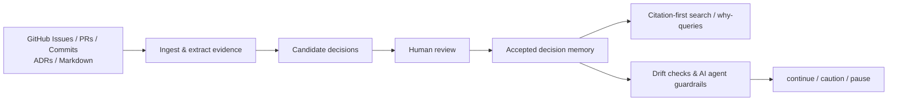
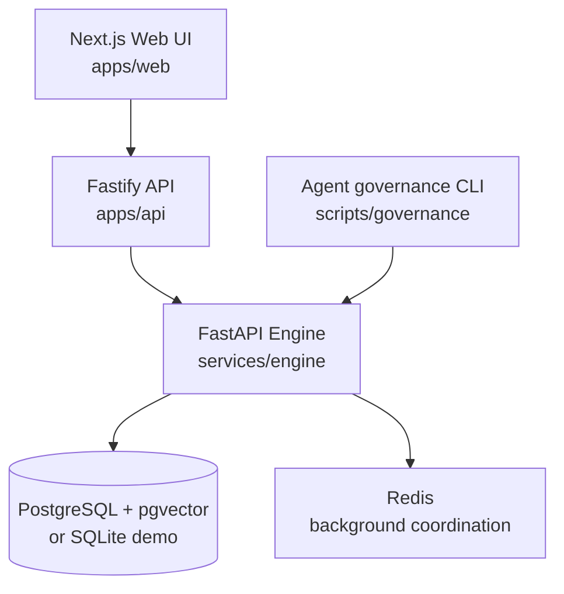

# DecisionAtlas

**Engineering decision memory for humans and AI coding agents.**

Turn scattered GitHub issues, pull requests, commits, ADRs, and engineering notes into **searchable, evidence-backed architectural decisions**. DecisionAtlas helps teams understand *why* code looks the way it does, review which decisions become trusted, detect drift, and give AI coding agents project-specific governance guidance.

[](LICENSE)
[](docs/project/deployment.md)
[](docs/project/governance-agent-guardrail.md)

**English** · [简体中文](README_zh-CN.md) · [Quick start](docs/project/quick-start.md) · [Architecture](docs/plans/2026-03-18-decisionatlas-project-blueprint.md) · [Documentation](#-documentation)

> **Project status:** An actively developed, local-first/self-hosted platform with a v0.3 release-candidate baseline. Governance checks are **advisory by default**, and this is not yet a fully managed, multi-tenant SaaS product.

## 📸 Real running UI

Captured by Playwright from the **actual Windows CI demo stack** at [main commit `93bbacd`](https://github.com/luzay-max/DecisionAtlas/commit/93bbacd378a8d24e1230d70d3cde3e3a7c719a06), not design mockups.

| Home · dark mode | Candidate decision review |
| --- | --- |
|  |  |

The current screenshots show the **Chinese-language UI**; English documentation is available below.

**[See all 8 screenshots](docs/project/ui-screenshots.md)** (desktop light/dark, workspace, Why Search and mobile screens) · [Verified main CI](https://github.com/luzay-max/DecisionAtlas/actions/runs/39728035244)

> Screenshots use **seeded demo data with Fake LLM providers**. They demonstrate real UI rendering, not the correctness of AI extraction from customer repositories or production deployment readiness.

## 🚀 Try it locally (Windows PowerShell)

The **seeded demo** is the simplest place to start. It runs the real Web/API/Engine services with a local SQLite database and **fake LLM/embedding providers**—no Docker, GitHub token, or paid AI API key is needed.

**Prerequisites:** Node.js **22 recommended** (the CI version), pnpm **10.6.0** (see `package.json`), Python **3.11+**, and [uv](https://docs.astral.sh/uv/). These commands target **Windows PowerShell**; other operating systems require following the individual-service instructions.

```powershell
git clone https://github.com/luzay-max/DecisionAtlas.git
cd DecisionAtlas
pnpm install
powershell -ExecutionPolicy Bypass -File .\scripts\dev\start-demo-stack.ps1
```

Open **http://localhost:3000**. The demo initializes isolated data under `.tmp/`, starts the three services, and uses seeded examples—not a live repository-quality benchmark.

Stop the demo when finished:

```powershell
powershell -ExecutionPolicy Bypass -File .\scripts\dev\stop-demo-stack.ps1
```

### Full local stack (PostgreSQL + Redis)

For an integration-style local setup, **start Docker Desktop first** and run:

```powershell
powershell -ExecutionPolicy Bypass -File .\scripts\dev\start-real-stack.ps1
```

The script starts Docker PostgreSQL/Redis, applies migrations, checks or seeds the demo workspace, and runs Web/API/Engine. It uses local development database credentials and **is not a production deployment script**. If an earlier walkthrough consumed the seeded review state, restore it explicitly with `-ResetSeededDemo`; don't assume a normal restart resets reviews.

```powershell
powershell -ExecutionPolicy Bypass -File .\scripts\dev\start-real-stack.ps1 -ResetSeededDemo
```

To stop the full stack:

```powershell
powershell -ExecutionPolicy Bypass -File .\scripts\dev\stop-real-stack.ps1
```

Health checks: [Web](http://localhost:3000) · [API](http://localhost:3001/health) · [Engine](http://localhost:8000/health).

**Next:** Follow the [guided walkthrough](docs/project/usage-guide.md), use the [quick-start and troubleshooting guide](docs/project/quick-start.md), or read the [deployment guide](docs/project/deployment.md). These commands are **not** a manual per-service setup; use the linked guide when debugging individual services.

## 🎯 Why DecisionAtlas?

Engineering teams often know **what** changed but lose track of **why**: the reasoning lives across PR conversations, issue discussions, ADRs, and internal notes. AI coding assistants face the same problem and can propose changes that unintentionally conflict with established decisions.

DecisionAtlas provides a reviewable decision layer between repository history and new work:

- **Remember the rationale** — preserve engineering decisions along with supporting source evidence.
- **Ask “why?”** — search decisions and retrieve citation-first, evidence-backed answers.
- **Detect drift** — flag potential mismatches between current changes and documented intent.
- **Guide AI coding agents** — give assistants structured `continue`, `caution`, or `pause` advice, while keeping human approval central.

## ✨ What you can do

| Capability | What it means |
| --- | --- |
| **Repository intelligence** | Import and incrementally sync GitHub issues, PRs, commits, Markdown, ADRs, and notes into a workspace. |
| **Decision extraction and review** | Generate candidate decisions and let reviewers accept, reject, or supersede them; candidates are not automatically trusted. |
| **Evidence-first search** | Ask architecture “why” questions with source citations and supporting context. |
| **Drift detection** | Evaluate rule-based and semantic drift signals, with conservative alert semantics. |
| **AI-agent guardrails** | Run governance checks against a change/diff and return structured JSON plus advisory status codes. |
| **Owner-scoped workflows** | Use local/bootstrap login, role-gated workspaces, and admin/operator GitHub App or private-repository bindings. |
| **Visual exploration** | Review decisions, timelines, search results, topology, and drift in a Next.js dashboard with dark/light themes. |
| **Flexible model setup** | Run an isolated demo with fake providers or configure an OpenAI-compatible LLM for live workflows. |

## 🔄 How it works



The key distinction: **extraction produces candidates, not policy by decree**. Humans review decisions, and agent-facing governance reports default to advice rather than silently rewriting code or blocking CI.

## 🏗 Architecture



| Layer | Technology | Responsibility |
| --- | --- | --- |
| Web | Next.js | Decision review, search, dashboards, timeline, drift, and topology |
| API | Fastify | Session/auth boundaries and owner-scoped actions |
| Engine | FastAPI / Python | Repository ingestion, extraction, retrieval, drift, and governance |
| Storage | PostgreSQL + pgvector / SQLite demo | Durable workspace data and vector retrieval |
| Background coordination | Redis | Full-stack background coordination |
| Agent integration | Python CLI | Machine-readable governance results and exit codes |

The repository also includes OpenSpec change management, automated tests, and a local setup workflow. See [deployment architecture](docs/project/deployment.md).

## 💬 Questions it helps answer

- *Why did we choose Redis as a cache rather than the primary database?*
- *Which PR or ADR explains our current authentication design?*
- *Does this new code change conflict with an accepted architecture decision?*
- *What should an AI coding agent review before making this change?*

## ✅ Development checks

For changes to this repository, CI validates Node tests, type checking, Engine tests, benchmark fixtures, and browser smoke flows on **Windows**. You can run focused checks locally:

```powershell
pnpm test
pnpm typecheck
uv run --project services/engine pytest -q
pnpm --filter @decisionatlas/web exec playwright test
```

Playwright requires its Chromium browser to be installed. Before release-style validation, consult the [pre-release gate](docs/project/quick-start.md) and run the governance CLI when applicable:

```powershell
python scripts\governance\agent_guardrail.py --protocol-status --summary
```

The CLI returns advisory `continue` / `caution` / `pause` guidance; it does not automatically approve a candidate decision or block CI.

## ⚙️ Configuration (Live Provider)

For a live provider-backed demo, configure these variables in your `.env`:

```env
LLM_PROVIDER_MODE=openai_compatible
LLM_API_KEY=your_api_key
LLM_MODEL=gpt-4o
EMBEDDING_MODEL=text-embedding-3-small
# Optional
EMBEDDING_API_KEY=your_api_key
LLM_BASE_URL=https://api.openai.com/v1
```

Live-provider requests may incur API charges. Use server-side environment configuration and never commit tokens. **The seeded demo uses Fake Providers regardless of these examples.** For setup and operator boundaries, see the [quick-start guide](docs/project/quick-start.md).

## 🧭 Contributing and project direction

DecisionAtlas uses OpenSpec for scoped engineering changes. Keep changes reviewable, run focused tests, record governance `caution` or `pause` decisions, and archive completed specifications as appropriate. See the [developer validation instructions](docs/project/quick-start.md) and [governance guardrail guide](docs/project/governance-agent-guardrail.md).

**Current focus (October 2026):** evidence traceability, trustworthy human review, real-repository evaluation, and safe self-hosting—not indiscriminate adoption of new agent/graph frameworks. The [security and real-repository validation plan](docs/plans/2026-10-21-security-hardening-and-real-repo-validation-plan.md) records the active baseline; the [evidence-first framework roadmap (PR #11)](https://github.com/luzay-max/DecisionAtlas/pull/11) is a **separate proposal under review**, not implemented functionality.

## 📚 Documentation

- [Usage Guide & Progress Update](./docs/project/usage-guide.md)
- [Quick Start](./docs/project/quick-start.md)
- [Deployment](./docs/project/deployment.md)
- [Self-Hosted Commercial Baseline](./docs/project/self-hosted-commercial-baseline.md)
- [Self-Hosted Readiness Checklist](./docs/project/self-hosted-readiness-checklist.md)
- [Code Decision Audit Template](./docs/project/code-decision-audit-template.md)
- [FAQ](./docs/project/faq.md)
- [Demo Script](./docs/project/demo-script.md)
- [Hosted Preview Readiness](./docs/project/hosted-preview-readiness.md)
- [Release Notes v0.3.0-rc.1](./docs/project/release-notes-v0.3.0-rc.1.md)
- [Governance Markdown Ingest](./docs/project/governance-markdown-ingest-mvp.md)
- [Governance Diff Checker](./docs/project/governance-diff-checker.md)
- [Governance Drift Detection](./docs/project/governance-drift-detection.md)
- [AI Agent Governance Guardrail](./docs/project/governance-agent-guardrail.md)
- [Architecture & Plans](./docs/plans/2026-03-18-decisionatlas-project-blueprint.md)
- [Current Execution Plan (2026-10-21): Security Hardening and Real-Repository Value Pilot](./docs/plans/2026-10-21-security-hardening-and-real-repo-validation-plan.md)
- [Historical Plans: Reviewed Archive Index](./docs/plans/archive/2026-10-21-reviewed-plan-index.md)
- [Real Repository Validation](./docs/project/real-repository-validation-baseline.md)

## ⚠️ Current limitations

- This is a **v0.3 release-candidate baseline for local/self-hosted evaluation**, not a production-ready managed SaaS, hosted SLA, or full multi-tenant organization console.
- GitHub App/private repository bindings are **admin/operator workflows**; Marketplace/OAuth self-service, a complete secret vault, billing, and collaborative multi-user review are not part of the current baseline.
- Local demo data comes from a **seeded SQLite workspace and Fake Providers**. Successful UI/browser checks do not prove real-model extraction accuracy or customer readiness.
- Source URLs and merged PR status alone do **not** establish that a candidate is a trustworthy adopted decision. Human review and evidence validation remain necessary.
- Drift results are intentionally conservative; imported real-repository workspaces may be sparse. AI-agent governance is **advisory by default**.
- A consumed demo review queue may need an explicit reset. See `-ResetSeededDemo` under [Full local stack](#full-local-stack-postgresql--redis) or the [demo recovery instructions](docs/project/quick-start.md).

---
*Project status and roadmap are documented with dated evidence; historical stage labels are not release certifications.*
