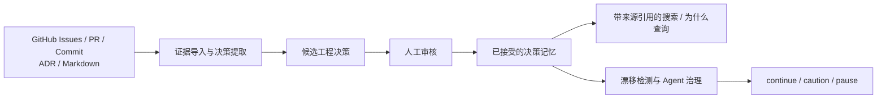
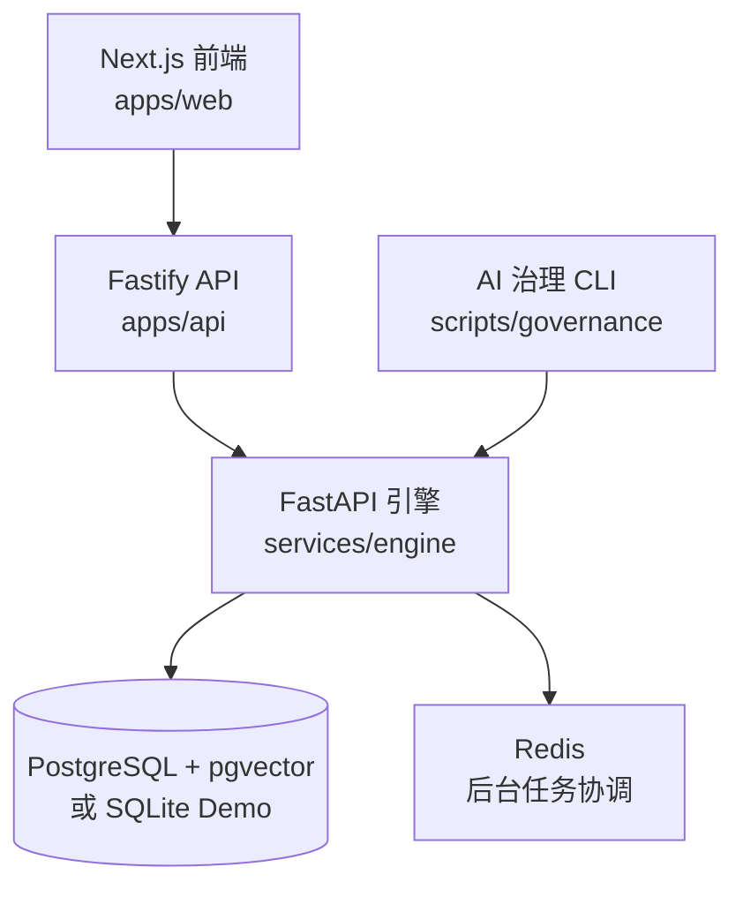

# DecisionAtlas · 工程决策记忆与 AI 治理平台

**让工程决策可追溯，让 AI 编程更了解项目的技术方向。**

DecisionAtlas 可以将分散在 **GitHub Issues、Pull Requests、Commits、ADR 和工程文档**中的信息，整理成**可搜索、可追溯且经过人工审核的工程决策记忆**。团队可以查询“当初为什么这样设计”，检查代码是否偏离既有架构决策，并为 AI 编程助手提供有依据的治理建议。

[](LICENSE)
[](docs/project/deployment_zh-CN.md)
[](docs/project/governance-agent-guardrail.md)

[English](README.md) · **简体中文** · [快速开始](docs/project/quick-start_zh-CN.md) · [项目架构](docs/plans/2026-03-18-decisionatlas-project-blueprint.md) · [完整文档](#-文档)

> **项目现状：** 持续开发中的本地优先 / 可自托管平台，目前具有 v0.3 RC 阶段的能力基础。AI 治理检查默认是**建议性（advisory）**的；项目目前还不是完整的多租户 SaaS 服务。

## 📸 真实运行截图

以下截图由 [主分支 `93bbacd` 的 GitHub Actions](https://github.com/luzay-max/DecisionAtlas/actions/runs/39728035244) 使用 Playwright 启动真实演示栈自动生成，**不是 AI 设计效果图**。

| 首页 · 深色模式 | 候选决策审核 |
| --- | --- |
|  |  |

**[查看全部 8 张真实截图](docs/project/ui-screenshots.md)**：桌面深浅色、工作区、原因检索、手机首页 / 工作区 / 审核。图片保存在 GitHub 仓库内，可长期查看。

> 截图使用**预置演示数据与 Fake Provider**，证明真实浏览器的界面与交互可运行，不代表真实仓库 AI 提取质量或生产环境已经完成验收。

## 🚀 本地快速体验（Windows PowerShell）

推荐先运行 **预置演示**：它会真实启动 Web/API/Engine 三端，但使用本地 SQLite、**Fake LLM/Embedding Provider** 和预置数据，**无需 Docker、GitHub Token 或付费模型 API Key**。

**环境要求**：推荐 Node.js **22**（与 CI 一致）、pnpm **10.6.0**（见 `package.json`）、Python **3.11+** 和 [uv](https://docs.astral.sh/uv/)。下面的命令面向 **Windows PowerShell**；其他系统请参照各服务的启动说明。

```powershell
git clone https://github.com/luzay-max/DecisionAtlas.git
cd DecisionAtlas
pnpm install
powershell -ExecutionPolicy Bypass -File .\scripts\dev\start-demo-stack.ps1
```

打开 **http://localhost:3000**。演示数据保存在独立的 `.tmp/` 中，用于体验审核、原因检索与漂移等流程；**演示成功不代表真实仓库 AI 提取质量已通过评估**。

演示结束后停止服务：

```powershell
powershell -ExecutionPolicy Bypass -File .\scripts\dev\stop-demo-stack.ps1
```

### 完整本地栈（PostgreSQL + Redis）

需要进行数据库/任务协同的本地开发时，**先启动 Docker Desktop**，再执行：

```powershell
powershell -ExecutionPolicy Bypass -File .\scripts\dev\start-real-stack.ps1
```

脚本会启动 Docker PostgreSQL/Redis、执行迁移、检查或初始化演示工作区，并启动三端服务。此脚本采用**本地开发数据库凭据，不适用于生产环境直接部署**。若此前的演示审核队列被消耗，可以明确指定 `-ResetSeededDemo` 还原预置演示状态；普通重启**不会自动重置**已经审核的数据。

```powershell
powershell -ExecutionPolicy Bypass -File .\scripts\dev\start-real-stack.ps1 -ResetSeededDemo
```

完整栈停止命令：

```powershell
powershell -ExecutionPolicy Bypass -File .\scripts\dev\stop-real-stack.ps1
```

访问入口：[Web](http://localhost:3000) · [API 健康检查](http://localhost:3001/health) · [Engine 健康检查](http://localhost:8000/health)。

**接下来**可以阅读[图文操作指南](docs/project/usage-guide.md)、[快速开始与故障排查](docs/project/quick-start_zh-CN.md)、[部署说明](docs/project/deployment_zh-CN.md)。上述命令均为自动化启动流程；如需逐服务调试，请参考详细指南。

## 🎯 为什么需要 DecisionAtlas？

开发者通常可以在 Git 中找到“改了什么”，却难以快速知道“**为什么这么改**”。理由可能散落在 PR 讨论、Issue、ADR 或 Markdown 规范里。AI 编程助手也面临相同的问题，容易在不了解历史决策的情况下提出与原定架构相冲突的修改。

DecisionAtlas 希望在历史代码和新变更之间，建立一层**可审核的工程决策知识层**：

- **记住决策依据**：记录工程决策，并保留对应的原始证据。
- **解释设计原因**：通过引用优先的搜索回答“为什么这样设计”。
- **发现技术漂移**：识别代码或方案与既定决策之间的潜在偏差。
- **辅助 AI 编程**：输出 `continue`、`caution`、`pause` 等结构化建议，保留人工审核环节。

## ✨ 核心能力

| 能力 | 作用 |
| --- | --- |
| **仓库知识摄取** | 导入 GitHub Issues、PR、Commit、Markdown、ADR 和工程笔记，支持增量同步。 |
| **决策提取和审核** | 提取候选决策，并由人工接受、拒绝或替代；候选决策不会自动变成可信规则。 |
| **有引用的智能搜索** | 查询项目的技术决策背景，并查看支撑结论的来源。 |
| **架构 / 治理漂移检测** | 通过规则和语义信号提示潜在偏差，采用保守的告警策略。 |
| **AI Agent 治理护栏** | 对代码变更执行治理检查，输出机器可读取的 JSON、状态和退出码。 |
| **多工作区与权限边界** | 支持本地登录、Owner Scope、角色操作，以及管理员操作的 GitHub App / 私有仓库绑定。 |
| **可视化工作台** | 提供决策审核、搜索、时间线、仪表盘、拓扑图和漂移视图，支持深浅色主题。 |
| **灵活模型接入** | 可用 Fake Provider 进行本地演示，也可配置兼容 OpenAI 的模型提供商。 |

## 🔄 工作原理



**项目不会把自动提取的结果直接当成权威规则。** 候选决策仍需人工审核；AI Agent 治理默认提供建议，不会自行改写项目代码或强制阻断 CI。

## 🏗 技术架构



| 模块 | 技术 | 职责 |
| --- | --- | --- |
| Web | Next.js | 决策审核、搜索、仪表盘、时间线、漂移和拓扑 |
| API | Fastify | Session、鉴权边界、Owner Scope |
| Engine | Python / FastAPI | 数据摄取、提取、检索、漂移检测、治理 |
| 数据层 | PostgreSQL + pgvector / SQLite Demo | 持久化数据和向量检索 |
| 后台协调 | Redis | 完整本地栈中的任务协调 |
| AI Agent 接口 | Python CLI | 机器可读的治理结果、状态码 |

仓库还包含 OpenSpec 变更管理、测试与部署脚本。详见[部署说明](docs/project/deployment_zh-CN.md)。

## 💬 可以解决哪些实际问题？

- *当初为什么选择 PostgreSQL 作为主数据库？*
- *哪一次 PR 或 ADR 记录了当前鉴权架构的设计理由？*
- *最近的代码修改是否与已接受的架构决策冲突？*
- *AI 编程助手在实施本次变更前，应该复查哪些约束？*

## ✅ 开发与质量检查

GitHub Actions 在 **Windows** 上执行 Node 测试、类型检查、Engine 测试、Benchmark Fixture 校验和浏览器冒烟测试。本地可按需执行：

```powershell
pnpm test
pnpm typecheck
cd services/engine
uv run pytest -q
cd ../..
pnpm --filter @decisionatlas/web exec playwright test
```

Playwright 需要事先安装 Chromium 浏览器。发布前请参考[快速开始中的标准发布门禁](docs/project/quick-start_zh-CN.md)，并按需要运行治理检查：

```powershell
python scripts\governance\agent_guardrail.py --protocol-status --summary
```

治理 CLI 的 `continue` / `caution` / `pause` 默认**只提供建议**，既不会把候选决策自动视为可信，也不会默认强制阻断 CI。

## ⚙️ 配置 (实时大模型提供商)

对于需要连接真实大模型提供商的演示，请在 `.env` 文件中配置以下变量：

```env
LLM_PROVIDER_MODE=openai_compatible
LLM_API_KEY=your_api_key
LLM_MODEL=gpt-4o
EMBEDDING_MODEL=text-embedding-3-small
# 可选配置
EMBEDDING_API_KEY=your_api_key
LLM_BASE_URL=https://api.openai.com/v1
```

真实模型调用可能产生费用，请仅通过服务端环境安全配置，不要把 Token/API Key 提交到仓库。**预置 SQLite 演示不会因此变成真实模型质量验证。** 详细配置和权限边界见[快速开始](docs/project/quick-start_zh-CN.md)。

## 🧭 参与开发与近期方向

DecisionAtlas 使用 OpenSpec 管理范围明确的变更。建议小步提交、运行对应测试、记录治理检查中的 `caution` / `pause`，并按项目规范归档已完成的规格。参见[开发与验证说明](docs/project/quick-start_zh-CN.md)和[AI Agent 治理指南](docs/project/governance-agent-guardrail.md)。

**当前重点（2026 年 10 月）**：证据可追溯、可信人工审核、真实仓库价值验证以及安全自托管；不为了追赶 Agent/图谱框架热度而盲目重构。[安全收口及真实仓库验证计划](docs/plans/2026-10-21-security-hardening-and-real-repo-validation-plan.md)记录已开展的工作；[证据优先框架改进路线 PR #11](https://github.com/luzay-max/DecisionAtlas/pull/11)是**仍在评审中的独立计划**，不代表相应功能已实现。

## 📚 文档

- [使用流程与优化建议 (Usage Guide)](./docs/project/usage-guide.md)
- [快速开始](./docs/project/quick-start_zh-CN.md)
- [部署指南](./docs/project/deployment_zh-CN.md)
- [常见问题 (FAQ)](./docs/project/faq_zh-CN.md)
- [演示脚本](./docs/project/demo-script_zh-CN.md)
- [Hosted Preview Readiness](./docs/project/hosted-preview-readiness_zh-CN.md)
- [v0.3.0-rc.1 发布说明](./docs/project/release-notes-v0.3.0-rc.1_zh-CN.md)
- [Governance Markdown Ingest](./docs/project/governance-markdown-ingest-mvp.md)
- [Governance Diff Checker](./docs/project/governance-diff-checker.md)
- [Governance Drift Detection](./docs/project/governance-drift-detection.md)
- [AI Agent Governance Guardrail](./docs/project/governance-agent-guardrail.md)
- [架构与规划](./docs/plans/2026-03-18-decisionatlas-project-blueprint.md)
- [当前执行计划（2026-10-21）：安全整改与真实仓库价值验证](./docs/plans/2026-10-21-security-hardening-and-real-repo-validation-plan.md)
- [历史计划审查与归档索引](./docs/plans/archive/2026-10-21-reviewed-plan-index.md)
- [真实仓库验证](./docs/project/real-repository-validation-baseline.md)

## ⚠️ 当前限制

- 目前是供**本地/自托管评估的 v0.3 RC 能力基线**，尚不是具备生产 SLA 的托管 SaaS 或完整多租户组织管理平台。
- GitHub App / 私有仓库绑定属于 **admin/operator 流程**；Marketplace/OAuth 自助安装、完整 Secret Vault、计费以及多人协同审核仍不在当前范围。
- SQLite 演示使用**预置数据和 Fake Provider**。浏览器截图与 CI 通过不代表真实模型提取准确率或客户生产场景已验收。
- **来源 URL 可访问、GitHub PR 已合并，不等于决策已被可信采纳**；仍需验证引用语义与实际人工审核。
- 漂移检测采取保守策略；真实仓库导入数据可能较少。AI Agent 护栏**默认仅提供建议**。
- 已消费的演示审核队列需要显式恢复：完整栈可使用上文 `-ResetSeededDemo`，更多说明见[演示恢复指南](docs/project/quick-start_zh-CN.md)。

---
*项目进度以有日期和证据的验证报告为准，历史阶段编号不等于当前发布认证。*
