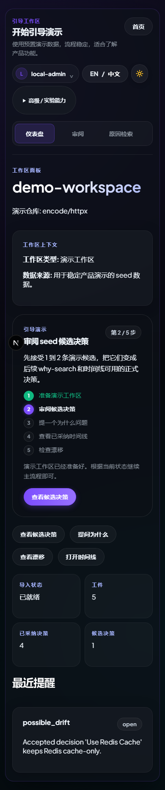
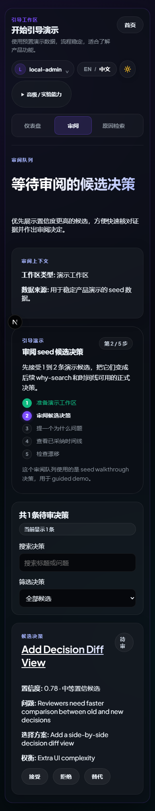

# DecisionAtlas · 真实运行界面截图 / Real UI screenshots

> **截图来源（2026-10-22）**：`main@93bbacd378a8d24e1230d70d3cde3e3a7c719a06` 的 [GitHub Actions CI #39728035244](https://github.com/luzay-max/DecisionAtlas/actions/runs/39728035244)，其中 Playwright 启动真实 Web/API/Engine 演示栈并生成 8 张 PNG。  
> **全部截图为实际浏览器页面，不是 AI 设计效果图。** 使用预置的 SQLite / Fake Provider **演示数据**，不代表真实仓库 AI 提取质量、客户生产部署或线上服务可用性。

[English README](../../README.md) · [中文 README](../../README_zh-CN.md) · [使用指南](usage-guide.md) · [原始 CI 与截图 Artifact](https://github.com/luzay-max/DecisionAtlas/actions/runs/39728035244)

## 1. 首页 / Home

| 中文深色主题 · Desktop dark | 中文浅色主题 · Desktop light |
| --- | --- |
|  |  |

首页提供引导演示入口、快捷工作区导航与高级仓库操作入口。浅色与深色主题均可切换。

## 2. 工作区与决策审核 / Workspace & review

### 工作区 / Workspace


工作区展示导入/候选/已采纳决策概览、五步演示流程和到审阅、检索、时间线、漂移页的导航。

### 候选审核 / Candidate review


审阅页包含候选列表、筛选、证据引用以及人工决定入口。**候选决策本身不等于已经被验证的工程知识。**

## 3. Why Search / 原因检索


面向“为什么这样设计？”的检索交互。演示截图为预置数据流程，不意味着真实 LLM 已通过人工正确性评分。

## 4. 手机端 / Mobile (390px)

| 首页 / Home | 工作区 / Workspace | 审核 / Review |
| --- | --- | --- |
|  |  |  |

手机端使用紧凑账户入口、可横向滚动的工作区导航、双列统计卡片和紧凑的审核筛选布局。屏幕宽度为 **390px**。

## 5. 溯源与复现 / Provenance & reproduction

| 属性 | 本次实际截图 |
| --- | --- |
| 截图日期 | 2026-10-22 |
| 来源提交 | [`93bbacd378a8`](https://github.com/luzay-max/DecisionAtlas/commit/93bbacd378a8d24e1230d70d3cde3e3a7c719a06)（主分支合并后的 UI 版本） |
| 实际运行环境 | GitHub Actions Windows runner，Playwright Chromium |
| 原始 CI | [CI #39728035244](https://github.com/luzay-max/DecisionAtlas/actions/runs/39728035244)（Success） |
| 截图生成测试 | [`apps/web/tests-e2e/ui-preview.spec.ts`](../../apps/web/tests-e2e/ui-preview.spec.ts) |
| 数据范围 | Seeded demo、SQLite、Fake LLM/Embedding（非真实客户仓库） |
| 截图保存方式 | **8 个 PNG 直接归档在本仓库的 `docs/assets/screenshots/`**，不会因 Actions Artifact 的保留期到期而失效 |

### 如何重新生成

按 [快速开始](quick-start_zh-CN.md) 安装依赖并启动演示环境，再运行：

```powershell
pnpm --filter @decisionatlas/web exec playwright test tests-e2e/ui-preview.spec.ts
```

此命令需先满足 `apps/web/playwright.config.ts` 中 Web/API/Engine 的运行配置，并使用 Playwright 已安装的 Chromium。CI 的完整脚本会自动启动测试用服务，建议直接参考 [`.github/workflows/ci.yml`](../../.github/workflows/ci.yml)。

### 阅读截图时的边界

- 截图中可能有 Next.js 开发环境标识 `N`；它不是生产环境 UI 元素。
- 本页面验证的是**真实浏览器渲染和基础交互**，不证明生产环境安全验收、真实私有仓库授权或模型提取准确率。
- 所有截图只来自公开的预置演示工作区；没有私有仓库内容或实际 API 密钥。
