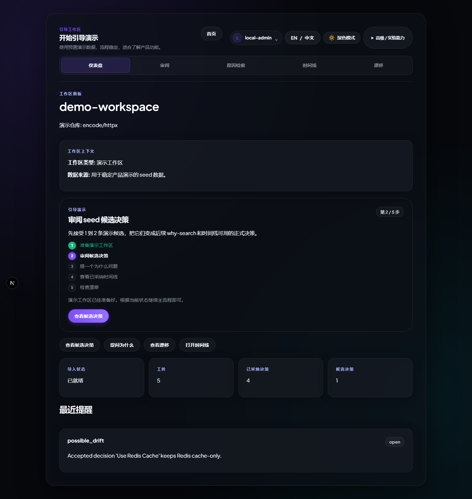
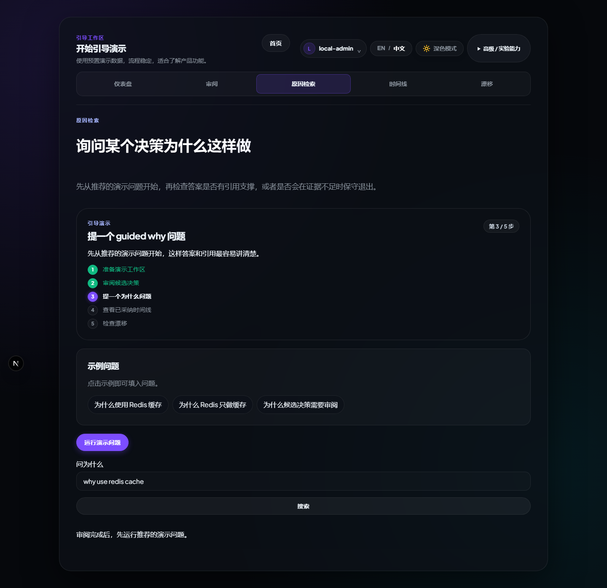
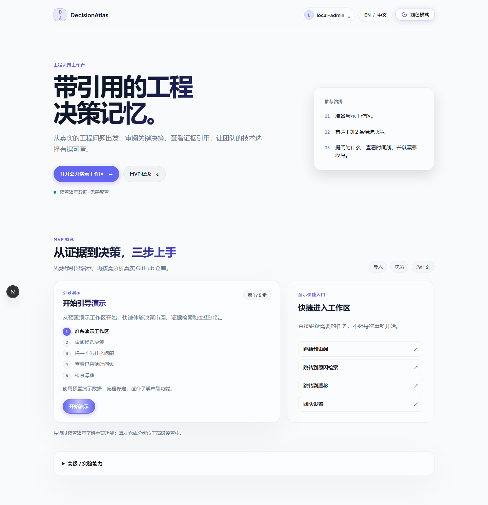
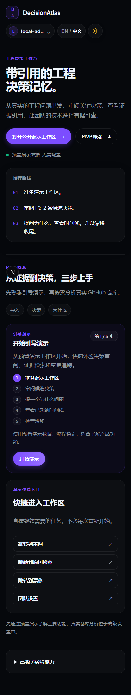

# DecisionAtlas 使用指南（2026-10-22）

本指南根据当前 `main` 分支的 UI 与演示运行流程更新。**优先通过预置演示工作区体验完整的「审核 → 原因检索 → 时间线 → 漂移」主线**，而不是直接用没有配置模型的真实仓库判断提取质量。

[中文 README](../../README_zh-CN.md) · [English README](../../README.md) · [8 张真实运行截图](ui-screenshots.md) · [快速开始](quick-start_zh-CN.md) · [部署指南](deployment_zh-CN.md)

## 1. 启动本地演示

最低要求：按[快速开始](quick-start_zh-CN.md)准备 Node.js/pnpm、Python 3.11+/uv 与所需依赖，执行：

```powershell
git clone https://github.com/luzay-max/DecisionAtlas.git
cd DecisionAtlas
pnpm install
powershell -ExecutionPolicy Bypass -File .\scripts\dev\start-demo-stack.ps1
```

浏览器打开 [http://localhost:3000](http://localhost:3000)。该命令会启动演示所需的 Web/API/Engine 服务；**演示数据由 Seed + Fake Provider 提供，不需要真实模型密钥**。若需要 PostgreSQL + Redis 的完整本地栈，参考[完整栈启动说明](quick-start_zh-CN.md)并运行：

```powershell
powershell -ExecutionPolicy Bypass -File .\scripts\dev\start-real-stack.ps1
```

不要按旧版教程单独运行 `poetry run` + `npm run dev`，否则很容易遗漏 API、演示数据初始化或状态依赖。

## 2. 先进入演示工作区


首页点击 **开始演示 / 打开公开演示工作区**，进入 `demo-workspace`；也可直接访问 `/workspaces/demo-workspace`。



工作区显示导入状态、工件、候选与已采纳决策的数量。上方的工作区导航可进入 **仪表盘、审阅、原因检索、时间线、漂移**。

## 3. 审阅候选决策


进入 **审阅**，按标题/问题搜索候选内容，并结合来源引用、候选的选择与权衡判断是否接受。未经人工审阅的候选**不自动等于可信的工程决策**。

如果预置候选被先前测试消费，可按[演示脚本](demo-script_zh-CN.md)或项目的 demo reset/reseed 流程重新初始化；不要把空队列误认为真实模型不工作。

## 4. 查询 Why Search 与后续结果



进入 **原因检索**，选择页面示例或输入具体「为什么选择这种设计」的问题。优先核对答案是否引用了已接受的决策与对应原始证据。证据不足、未采纳或内容稀疏时应如实返回受限结果，而非编造理由。

然后使用顶部 **时间线** 查看已采纳决策演进，进入 **漂移** 查看是否存在需要人工处理的变更偏差。

## 5. 深浅主题与手机端

| 浅色首页 | 手机端首页 |
| --- | --- |
|  |  |

手机端还有 [工作区](../assets/screenshots/07-workspace-mobile-dark-zh.png) 与 [审核页](../assets/screenshots/08-review-mobile-dark-zh.png) 的完整截图。账户操作收进可展开菜单，统计卡片双列显示，工作区导航可横向滚动。

## 6. 真实仓库导入（与演示数据区分）

真实导入需要正确的 GitHub 访问权限，以及按配置决定是否需要兼容 OpenAI 的真实模型提供商。

1. 按[真实服务配置指南](quick-start_zh-CN.md)启动完整栈并配置正确的变量；**永远不要把 GitHub Token / API Key 粘贴到 Issue、PR、截图或公开仓库**。
2. 只用你有权访问的公开或私有仓库；私有仓库还涉及管理员权限、服务器端凭据加密和密钥管理。
3. 查看导入任务的失败原因、进度、候选决策和证据引用；“导入成功”不代表提取到的候选已通过真实质量验收。
4. 人工审核候选的**问题、选定方案、证据和实际采纳状态**，之后才把可信结论用于 Why Search 和漂移判断。

截至本文更新，公开仓库 `pallets/click` 使用 **FakeProvider** 的 8 条候选中，AI 辅助审核为 0 接受 / 7 拒绝 / 1 不确定；**这不是对真实付费模型的质量测量**。见[公开候选证据核查报告](../validation/2026-10-21-pallets-click-eight-candidate-independent-audit.md)。

## 7. 运行与截图验证

[真实截图图集及其来源](ui-screenshots.md)记录了主分支已通过的 [CI #39728035244](https://github.com/luzay-max/DecisionAtlas/actions/runs/39728035244)、代码 SHA 和截图测试路径。

常规检查：

```powershell
pnpm --filter @decisionatlas/web typecheck
pnpm --filter @decisionatlas/web exec playwright test
```

Playwright 测试会根据 [`apps/web/playwright.config.ts`](../../apps/web/playwright.config.ts) 启动所需服务；在 Windows CI 中使用 `playwright install --no-shell chromium` 与 Chromium 新无头模式。截图为真实浏览器渲染，**不是生产部署证明**。

## 8. 使用边界

- **演示**：SQLite + Fake Provider，强调流程、交互和视觉可复现。
- **真实分析**：结果依赖 GitHub 源数据、模型配置、已采纳证据与质量评审，不能从截图推断质量。
- **安全与运维**：上线前仍需校验凭据存储、Session 边界、权限、密钥备份恢复及客户环境部署。
- **AI Agent 治理**：当前默认提供建议，不能擅自修改代码或强制将候选决策当成治理规则。

后续产品改进原则：基于真实仓库的人工证据评审与端到端验收，优先解决确认的阻断问题，避免为了 UI 或框架热度而扩大开发范围。
