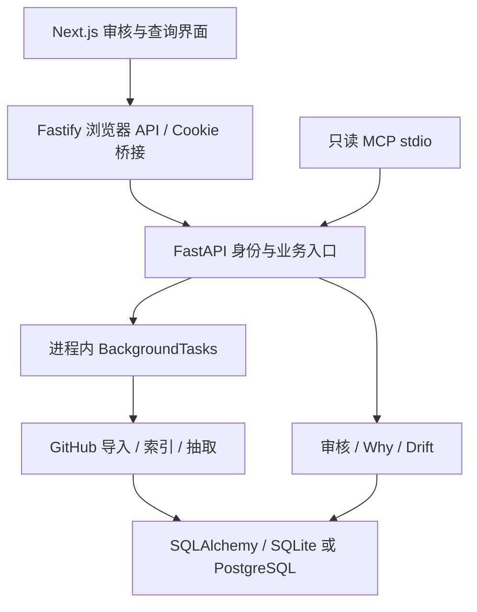
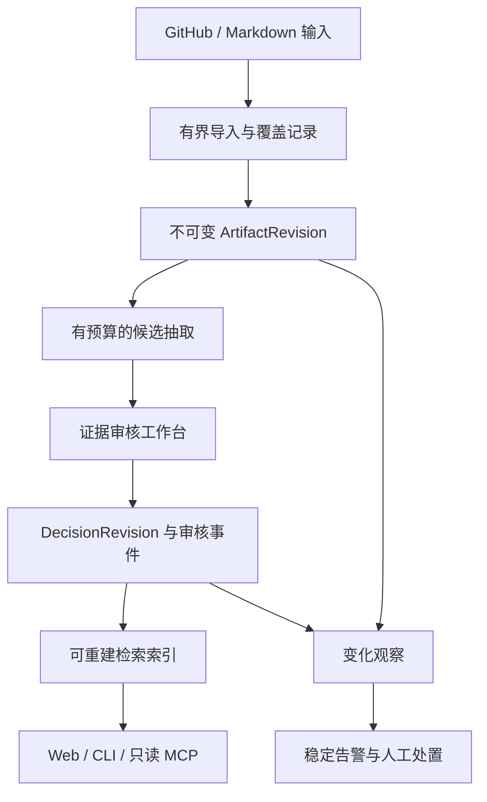

# DecisionAtlas 深度审查：未来方向、架构、代码与用户体验

- 日期：2026-10-28（Asia/Shanghai）；外部资料检索于 2026-10-27，仓库状态于 2026-10-28 再核对。
- 审查基线：[`main@465223b5a7dd75a885fc0391a62e09fc369f4a36`](https://github.com/luzay-max/DecisionAtlas/tree/465223b5a7dd75a885fc0391a62e09fc369f4a36)。
- 性质：供维护者决定未来方向的 RFC / 审查报告；建议尚未批准或实施。
- 本次交付只有文档，不更改产品代码、不合并其他 PR、不运行付费模型、不访问私有仓库。

## 1. 结论：值得继续，但需要从“功能平台”收敛为“可信项目决策记忆”

**建议继续投入，以“小团队和开源维护者的、可验证且可携带的项目决策记忆”为产品主线；以 Web 完成人工审核，以 MCP/CLI 把已审核的理由带进日常开发。**

推荐的一句话定位：

> 让开发者和 AI 知道项目为什么这样设计；每条理由都有来源、适用范围、版本和审核记录。

DecisionAtlas 的价值不在于再提供一个聊天框，也不在于“能接多少种模型或代码托管平台”。它有机会解决更具体的问题：新成员或 Agent 准备改代码时，快速找到之前的取舍，知道哪些是已采纳的决策、哪些只是建议，避免重复争论或重走失败路线。

当前代码已经具备导入、候选抽取、审核、来源引用、问答、漂移提示、权限和只读 MCP 的骨架，推倒重写不划算。但目前还不能据此证明真实团队愿意持续使用，更不能保证成为热门开源项目。**最重要的下一阶段不是扩功能，而是用可靠闭环证明“减少查找理由的时间”，并解决会破坏信任的数据和交互问题。**

建议未来 90 天只保留三条主线：

1. **可信度**：稳定的来源版本、审核历史、同步完整性与告警处置语义。
2. **首次价值**：新用户十分钟内看到一条真实、可核对的决策，并能在 Agent 中查询。
3. **可维护性**：统一契约、可靠任务、可复现评测和低成本检索。

这里的“十分钟”以及后文目标都是待验证的产品目标，不是现状成绩或服务承诺。

## 2. 审查范围与证据等级

### 2.1 做了什么

遍历基线的完整 Git tree，建立模块清单；取回主要生产源码、测试、工作流和迁移文件。通过源码阅读追踪以下路径：

| 路径 | 重点 |
| --- | --- |
| Next.js → Fastify → FastAPI | Cookie/session、scope 切换、请求路由、错误处理 |
| GitHub API → ImportJob → Artifact | 分页、增量水位、事务、暂停、来源捕获 |
| Artifact → Chunk → Candidate → SourceRef | 去重、版本、引用定位、抽取边界 |
| Review → Why/Drift → MCP | accepted 边界、检索成本、处置持久性、工作区隔离 |
| Web 页面和组件 | 首次使用、审核动作、图谱表达、失败与恢复 |
| CI / Alembic / 项目文档 | 测试覆盖边界、环境差异、开源维护成本 |

本地取回的生产模块包括 Engine app 88 个文件（约 13,054 行）、API src 16 个文件（约 1,125 行）、Web components 43 个文件（约 6,713 行）。这些数字是本次取得的文本快照统计，不是全仓库 LOC，也不代表每行均完成形式化审计。核心链路深入阅读，周边测试、治理脚本和文档按风险抽样。

### 2.2 证据等级

- **R：函数级复现**：执行基线函数体，使用内存替身隔离数据库/网络；不是完整服务测试。
- **S：源码链路确认**：调用者、被调用者及数据结构能够直接支持结论，尚无浏览器或数据库端到端复现。
- **H：风险假设**：存在触发条件，须通过并发、负载、真实运行或用户研究确认。
- **P：方向提案**：产品/架构取舍，必须用效果和成本验证。

没有在本环境运行完整 pytest、pnpm、Playwright、PostgreSQL 或真实 MCP Host：当前环境缺少项目依赖，直接 Git clone 未成功，改用 GitHub 连接器取得固定 SHA 源码。本报告不把“分析源码”写成“全量测试通过”，不把现有截图当成本次视觉验收，不把 FakeProvider 结果当真实模型质量。

现有测试和 CI 是值得保留的资产。此次发现更说明需要增加跨层、生命周期及状态迁移测试，而不是否定已有测试。

## 3. 当前架构及可保留的资产

### 3.1 做得对的地方

- **候选与已采纳决策分离**：抽取写 candidate；Why 与 MCP 的关键路径读取 accepted，降低模型生成内容直接变规则的风险。
- **来源模型已成形**：Artifact、SourceRef、quote/span、导入捕获 hash、ReviewAuditEvent 可以发展为可验证证据链。
- **保守诊断**：`evaluate_evidence` 明确区分字符串定位、快照完整性、远端真实性和语义支持，不自动批准决策。见 [services/engine/app/extractor/evidence.py:21](https://github.com/luzay-max/DecisionAtlas/blob/465223b5a7dd75a885fc0391a62e09fc369f4a36/services/engine/app/extractor/evidence.py#L21)。
- **已有权限边界**：Engine 校验 owner scope 和 workspace role，不能仅靠前端隐藏按钮；默认禁用自动 bootstrap。
- **MCP 足够克制**：预绑定工作区、loopback、只读工具、accepted 二次过滤、拒绝重定向；可以渐进产品化。见 [services/engine/app/mcp/bridge.py:62](https://github.com/luzay-max/DecisionAtlas/blob/465223b5a7dd75a885fc0391a62e09fc369f4a36/services/engine/app/mcp/bridge.py#L62)。
- **有真实工程积累**：迁移、API/组件测试、Windows CI、浏览器烟测、双语文档都存在，不是只有原型截图。

### 3.2 不应继续沿用的假设

1. PostgreSQL 安装了 pgvector，不等于当前决策检索使用了数据库向量索引。
2. API 有路由，不等于浏览器经 BFF 能调用；单层 mock 测试可能放过接口缺失。
3. 状态为 succeeded，不等于导入覆盖完整，也不等于候选正确。
4. accepted 表示一次人类审核，不能自动代表后续更新后的来源仍支持该决定。
5. “拓扑图”和“治理已暂停”是很强的产品表达，必须对应真实关系与执行动作。
6. 进程内后台任务加持久化 job 表，不等于已经拥有可恢复任务队列。

## 4. 问题总表与处置顺序

P0 表示在受影响部署/功能继续放大前优先处理；P1 表示下一阶段核心修复；P2 表示随产品收敛改进。不是 CVSS 或漏洞评级。

| ID | 问题 | 等级 | 优先级 | 用户影响 |
| --- | --- | --- | --- | --- |
| F01 | Web 暂停/恢复缺 BFF 路由，失败被吞掉 | S | P1 | 按钮看似可用，实际无反馈 |
| F02 | scope 切换响应不是完整 ProductSession | S + JS 探针 | P1 | 多 scope 用户切换后页面可能崩溃 |
| F03 | 重新漂移检测覆盖/删除已有处置 | R + S | P1 | 误报反复出现，审核劳动丢失 |
| F04 | GitHub 分页/树截断不显式报告不完整 | R + S | P1 | 部分历史被当成成功导入 |
| F05 | 增量同步以完成时间作水位 | S | P1 | 执行期间更新存在漏采窗口 |
| F06 | 原始 Artifact 被覆盖，抽取去重只看有无引用 | S | P1 | 旧决策与新来源错位，更新不重新抽取 |
| F07 | 空内容重建索引没有清除旧 Chunk | R | P1 | 已清空内容仍残留索引 |
| F08 | 每次查询重新嵌入全部 accepted 决策 | R + S | P1 | 成本和延迟随数据量线性增长 |
| F09 | 中文词法检索为空；fake embedding 参与排序 | R + S | P1 | 中文体验及“live”能力认知不一致 |
| F10 | 浏览器 API 地址使用非公开 env 并默认 loopback | S | P1（远程部署） | 服务端正常，远程浏览器请求自身机器 |
| F11 | 图谱以硬编码模块及时间顺序代替真实关系 | S | P1（产品可信度） | 外部仓库被解释成错误架构 |
| F12 | 工作区治理横幅实际检查服务仓库，声称已暂停 Agent | S | P1（产品可信度） | 对象与执行状态表达失真 |
| F13 | Cookie 解析遇到非法百分号直接抛异常 | R | P2 | 无关坏 Cookie 也可导致请求失败 |
| F14 | 长任务缺 durable worker/claim/恢复协议 | H，机制缺口已确认 | P1 | 重启、并发和暂停恢复不可靠 |
| F15 | 配置/检索/审核契约分散与手写 | S/H | P2 | 重复实现、行为漂移、维护费高 |
| K01 | 已知 raw 下载凭据隔离及导入中途提交 | 已有 PR #26 | P0（相关路径） | 先完成既有修复评审，不重复另造方案 |

### F01. 暂停/恢复链路断裂

**证据**：[apps/web/lib/api.ts:1026](https://github.com/luzay-max/DecisionAtlas/blob/465223b5a7dd75a885fc0391a62e09fc369f4a36/apps/web/lib/api.ts#L1026) 发 POST `/imports/{jobId}/pause` 和 `/resume`；Engine [services/engine/app/api/imports.py:276](https://github.com/luzay-max/DecisionAtlas/blob/465223b5a7dd75a885fc0391a62e09fc369f4a36/services/engine/app/api/imports.py#L276) 有对应路由，但 [apps/api/src/routes/imports.ts:54](https://github.com/luzay-max/DecisionAtlas/blob/465223b5a7dd75a885fc0391a62e09fc369f4a36/apps/api/src/routes/imports.ts#L54) 只注册了查询、导入、绑定及 webhook 等路由，没有这两个 POST 转发。Web [apps/web/components/dashboard/demo-import-button.tsx:225](https://github.com/luzay-max/DecisionAtlas/blob/465223b5a7dd75a885fc0391a62e09fc369f4a36/apps/web/components/dashboard/demo-import-button.tsx#L225) 的 catch 是空的。

**触发**：默认 Web → Fastify 部署中点击正在运行任务的暂停按钮。按注册路由推导会返回 404，UI 不解释失败；本次未启动完整服务复现 HTTP 结果。

**修复**：补转发和权限/错误契约；按钮等待服务端确认后更新状态；错误可见并可重试。先不要承诺即时暂停，定义“当前原子步骤结束后暂停”。

**验收**：经真实 BFF 的 pause/resume 成功、403、404、409 都有测试；双击不会重复提交；失败不伪造 paused 状态。另补轮询网络错误后的 finally/retry：`waitForJob` 缺少异常收尾，effect 中 promise 缺 catch；开发 StrictMode 的 effect cleanup 后 `mountedRef` 没有重新置 true，也应专门验证。

### F02. 切换 scope 的返回结构不完整

**证据**：[services/engine/app/api/auth.py:116](https://github.com/luzay-max/DecisionAtlas/blob/465223b5a7dd75a885fc0391a62e09fc369f4a36/services/engine/app/api/auth.py#L116) 只返回 `current_owner_scope`、`role`、`session_token`；[apps/web/components/auth/session-provider.tsx:87](https://github.com/luzay-max/DecisionAtlas/blob/465223b5a7dd75a885fc0391a62e09fc369f4a36/apps/web/components/auth/session-provider.tsx#L87) 将响应直接 `setSession(nextSession)`；[apps/web/components/auth/account-scope-surface.tsx:45](https://github.com/luzay-max/DecisionAtlas/blob/465223b5a7dd75a885fc0391a62e09fc369f4a36/apps/web/components/auth/account-scope-surface.tsx#L45) 立即读取 `available_scopes.find` 和 `actor.username`。TypeScript 的 Promise 类型标注不能验证真实 JSON。

**验证**：源码 AST 提取了三个返回字段；将同形状对象交给消费者的 `.find` 表达式，Node 报 `TypeError`。这是契约级验证，不是完整 React 渲染。

**修复**：scope endpoint 统一返回完整 SessionDTO，或切换成功后重新 GET session；优先前者。跨 scope 缓存必须失效，避免旧数据在新 scope 页面暂留。

**验收**：两个 scope 的真实响应贯通 Engine→BFF→Provider→组件；账户信息、权限和可选 scope 都保留；并行旧请求不能覆盖新 scope 状态。

### F03. 漂移检测破坏用户已处理状态

**证据**：[services/engine/app/drift/evaluator.py:87](https://github.com/luzay-max/DecisionAtlas/blob/465223b5a7dd75a885fc0391a62e09fc369f4a36/services/engine/app/drift/evaluator.py#L87) 为规则信号传入 `status="open"`；[services/engine/app/repositories/drift_alerts.py:16](https://github.com/luzay-max/DecisionAtlas/blob/465223b5a7dd75a885fc0391a62e09fc369f4a36/services/engine/app/repositories/drift_alerts.py#L16) 更新现有 alert 时无条件改 status。相同 evaluator 又删除 `possible_supersession` / `needs_review` 再生成，没有按用户 disposition 排除。

**验证**：直接运行 `create_or_update` 的现有更新分支，输入 false_positive 的 alert，输出变成 open，而 handled_by/rationale 仍保留，出现状态与处理记录矛盾。语义告警删除路径经源码确认，未在数据库执行。

**修复**：分离 `SignalObservation` 和 `AlertDisposition`；用稳定 fingerprint 识别同一事实；重复检测更新 last_seen 和 occurrence，不覆盖处置。来源版本变化可生成新观察，并明确“为何重新打开”。不要通过 delete/recreate 刷新可审计对象。

**验收**：resolve/false_positive 后重复 evaluate 保持处置和审计关联；真正变化按明确策略重新告警；所有操作可重复执行而不制造重复通知。

### F04. 不完整导入被隐藏

**证据**：[services/engine/app/ingest/github_client.py:192](https://github.com/luzay-max/DecisionAtlas/blob/465223b5a7dd75a885fc0391a62e09fc369f4a36/services/engine/app/ingest/github_client.py#L192) 达到 `max_pages` 后直接 break 返回列表；422 且 page>1 也直接停止；`list_repository_files` 未检查 Git tree `truncated` 标志。配置默认最多 5 页、每页 100 条。

**验证**：以 max_pages=2 和始终存在 next 的模拟响应执行原 `_paginate`，仅返回两页，没有异常或 incomplete 标记。

**修复**：不是简单取消上限。返回 `coverage / cursor / truncated_reason / fetched_count / requested_scope`；区分“最近 N 条分析”与“完整历史”。遇到 API 异常不把错误解释成自然分页终点。选择性导入可以保留，只需明确契约。

**验收**：页数超限、422、树截断都显示部分覆盖；水位只在指定覆盖范围成功后推进；Why/MCP 返回所分析范围。

### F05. 增量水位有漏采窗口

**证据**：[services/engine/app/jobs/import_jobs.py:155](https://github.com/luzay-max/DecisionAtlas/blob/465223b5a7dd75a885fc0391a62e09fc369f4a36/services/engine/app/jobs/import_jobs.py#L155) 优先拿上次 finished_at 传给 provider；GitHub 数据抓取早于索引与模型抽取完成。

**场景**：10:00 开始；10:01 已抓取 Issues；10:03 上游 Issue 更新；10:10 抽取完成。下一次从 10:10 开始请求，该更新可能从未被采集。此为代码时序推导，未做真实 GitHub 定时更新实验。

**修复**：为各数据流维护水位，使用任务开始时确定的边界/游标及重叠窗口，按稳定源 ID + 版本幂等。commit 则优先 SHA/祖先关系，不能只靠作者时间覆盖 rebase/补推情况。失败或覆盖不完整不推进水位。

**验收**：更新发生在抓取后、任务完成前仍会被下一轮取得；分页边界同时间记录不遗漏；重试不重复候选。

### F06. 可变 Artifact 与不可变审核语义冲突

**证据**：[services/engine/app/repositories/artifacts.py:13](https://github.com/luzay-max/DecisionAtlas/blob/465223b5a7dd75a885fc0391a62e09fc369f4a36/services/engine/app/repositories/artifacts.py#L13) 原位覆盖 content 和 metadata；[services/engine/app/extractor/pipeline.py:505](https://github.com/luzay-max/DecisionAtlas/blob/465223b5a7dd75a885fc0391a62e09fc369f4a36/services/engine/app/extractor/pipeline.py#L505) 通过 `not exists_for_artifact(id)` 决定是否再次抽取。SourceRef 指向 artifact_id，没有版本 ID。更新后的内容与新的捕获 hash 可以一致，但此前接受决策时看到的原文已不再是该行的内容。

**后果**：已抽取过的 ADR 改变选择后，可能既不生成新候选，也不把旧 accepted 标成来源已变。旧 quote 仍存着，却不一定能在当前 Artifact 定位。Phase E 的 hash 提高了捕获完整性，但没有解决历史版本身份。

**修复**：引入 `ArtifactRevision`，SourceRef 绑定 revision；抽取缓存键至少包含 content hash、extractor/prompt version。保留 accepted 的原证据快照，新来源变化产生 stale/review-needed 提醒，不能静默改写已接受的理由。

**验收**：同源 v1→v2 可分别重现；v1 审核记录不变；v2 产生可解释差异；删除来源有 tombstone；真实删除与“分页没取到”不得混淆。

### F07. 空内容重新索引留下旧片段

**证据**：[services/engine/app/indexing/index_artifact.py:10](https://github.com/luzay-max/DecisionAtlas/blob/465223b5a7dd75a885fc0391a62e09fc369f4a36/services/engine/app/indexing/index_artifact.py#L10) 在 `chunk_text(content)` 为空时直接 return 0，未调用 `replace_for_artifact`；正常替换的清理发生在 [services/engine/app/repositories/artifact_chunks.py:13](https://github.com/luzay-max/DecisionAtlas/blob/465223b5a7dd75a885fc0391a62e09fc369f4a36/services/engine/app/repositories/artifact_chunks.py#L13)。

**验证**：执行原函数、令 chunker 返回空，记录到的存储操作为空。已有索引不会被该调用清掉。

**修复**：空结果仍进入替换/清除事务；与版本及删除语义统一。

**验收**：先索引非空文档再清空；旧 Chunk 为零，问答不会再引用旧片段。此处不主张删除历史审计快照，历史版本应由独立模型保留。

### F08. 决策检索每次都重新计算文档向量

**证据**：[services/engine/app/retrieval/vector_search.py:14](https://github.com/luzay-max/DecisionAtlas/blob/465223b5a7dd75a885fc0391a62e09fc369f4a36/services/engine/app/retrieval/vector_search.py#L14) 每次查询加载所有 accepted，先 embed(query)，再 embed(全部 decision_texts)。已有 ArtifactChunk embedding 没被此决策检索函数复用。`_similarity` 为 dot product，没有维度校验；对非单位化 provider 向量可能受模长影响。

**验证**：3 个决策、相同查询两次，原函数产生 embedding batch sizes `[1,3,1,3]`，文档向量没有缓存。

**成本模型**：Q 次查询、N 个决策、每条平均 D token，文档侧重复处理约 Q×N×D token；实际费用取决于所选 provider，不在此虚构价格。Drift 对每个 Artifact 召回时还可能放大同一路径成本。

**修复**：DecisionEmbedding 按 decision revision + model + dimension 缓存；查询只嵌入 query；SQLite 小数据可用本地有界计算，PostgreSQL 达到需要时再用 pgvector。候选召回限制 top-k，检索与 rerank 分层。dot/cosine 的契约必须与模型规格一致。

**验收**：相同版本决策只计算一次向量；模型切换有独立索引；拒绝维度不符/非有限值；固定数据集比较 recall@k、p95 与每次查询 token。

### F09. 双语承诺与实际词法能力不一致

**证据**：[services/engine/app/retrieval/full_text.py:54](https://github.com/luzay-max/DecisionAtlas/blob/465223b5a7dd75a885fc0391a62e09fc369f4a36/services/engine/app/retrieval/full_text.py#L54) 只匹配 `[a-z0-9]`；中文问题“为什么选择消息队列”得到空 token。抽取前置信号词也主要为英语，中文材料可能在模型前就被筛掉。MCP 使用另一套 `\w+` 规则，不等于中文分词。

[services/engine/app/llm/provider_factory.py:20](https://github.com/luzay-max/DecisionAtlas/blob/465223b5a7dd75a885fc0391a62e09fc369f4a36/services/engine/app/llm/provider_factory.py#L20) 允许 live LLM + FakeEmbedder；FakeEmbedder 返回文本长度及位置，[services/engine/app/retrieval/hybrid.py:21](https://github.com/luzay-max/DecisionAtlas/blob/465223b5a7dd75a885fc0391a62e09fc369f4a36/services/engine/app/retrieval/hybrid.py#L21) 仍把其分数作为 vector 通道融合。`is_live=True` 此时不代表语义检索真实可用。最终 Why 还有保守校验，不能据此声称它必然输出错误答案。

**修复**：明确区分 extraction_mode 和 retrieval_mode；无真实向量能力时使用 lexical-only 并显示说明。加入 Unicode/CJK 词法策略和中英混合技术词测试，先用评测决定 tokenizer/FTS，而不是默认增加大模型调用。

**验收**：中文、英文、混合类名/路径、无匹配问题单独统计；FakeEmbedder 不参与真实 workspace 相关性排名；unknown 仍是合法结果。

### F10. 远程浏览器可能请求自己的 127.0.0.1

**证据**：[apps/web/lib/api.ts:450](https://github.com/luzay-max/DecisionAtlas/blob/465223b5a7dd75a885fc0391a62e09fc369f4a36/apps/web/lib/api.ts#L450) 使用 `process.env.API_BASE_URL ?? "http://127.0.0.1:3001"`；该模块被 client components 导入，Next config 没有公开该变量或设置同源 rewrite。非 `NEXT_PUBLIC_` env 通常只在服务端可用，见外部资料 S06。

**影响边界**：本机默认启动不一定失败；远程访问、HTTPS 域名或更换 API 端口时，SSR 与浏览器请求可能指向不同地址。这里是源码及框架契约确认，未做生产 build/远程浏览器复现。

**修复**：浏览器统一使用同源 `/api`，内部地址仅留在服务器；服务端 fetch 单独封装。相比暴露绝对地址，这能减少 CORS、Cookie 和环境配置分叉。

**验收**：在非 loopback 主机名、HTTPS 反代、非默认端口下完成登录→导入→审核；浏览器 network 中无意外 localhost 请求。

### F11. 拓扑图不能代表外部仓库的真实架构

**证据**：[apps/web/components/timeline/decision-topology-map.tsx:35](https://github.com/luzay-max/DecisionAtlas/blob/465223b5a7dd75a885fc0391a62e09fc369f4a36/apps/web/components/timeline/decision-topology-map.tsx#L35) 固定 `services/engine`、`apps/api`、`apps/web`、`docs/ADRs`；用关键词分类，再将同类决策按时间连线。组件没有消费经过审核的依赖/替代关系，也修改了全局 String.prototype。

**修复**：短期改名为“决策时间聚类（启发式）”，不展示伪模块映射；长期只有在明确 `supersedes / constrains / relates_to` 关系及证据来源存在时才画关系边。未知范围归为“未标注”。删除 String 原型扩展。

**验收**：Python CLI、Java 服务和前端仓库不会自动冒出 DecisionAtlas 模块；每条关系可解释来自何处；支持键盘选择、可读列表替代和 reduced-motion。

### F12. 治理检查的对象与 UI 话术不一致

**证据**：[services/engine/app/api/governance.py:250](https://github.com/luzay-max/DecisionAtlas/blob/465223b5a7dd75a885fc0391a62e09fc369f4a36/services/engine/app/api/governance.py#L250) 固定 `root=REPO_ROOT`，没有导入 workspace 对应 checkout/diff 的绑定；[apps/web/components/governance/guardrail-pause-banner.tsx:8](https://github.com/luzay-max/DecisionAtlas/blob/465223b5a7dd75a885fc0391a62e09fc369f4a36/apps/web/components/governance/guardrail-pause-banner.tsx#L8) 虽接收 workspaceSlug，却调用无 workspace 参数的 API，并显示 “AI agent has automatically paused code execution”。当前这条 Web 调用链没有暂停某个外部 Agent 的控制接口。

**修复**：将自仓库开发检查与用户项目治理分开。结果必须含 target repo、revision/diff digest、evaluated_at、scope 和 advisory/enforced 状态。UI 使用“建议暂停并审核”，只有确认执行器已停止才说“已暂停”。若目标上下文未绑定，显示未评估。

**验收**：两个不同工作区不会无说明显示同一服务仓库结果；缺目标时不伪造 continue；错误不可静默等同无风险。

### F13. Cookie 解析容错不足

**证据**：[apps/api/src/auth.ts:7](https://github.com/luzay-max/DecisionAtlas/blob/465223b5a7dd75a885fc0391a62e09fc369f4a36/apps/api/src/auth.ts#L7) 对所有 Cookie 值直接 `decodeURIComponent`，未捕获 URIError。

**验证**：执行该函数体，传入合成 `unrelated=%`，抛出 `URIError: URI malformed`。无需真实凭据，未访问线上接口。

**修复**：只解析需要的 Cookie，使用成熟解析器或逐值容错；对非法会话明确 400/401，不让无关 Cookie 变 500。

**验收**：非法转义、重复 Cookie、空值、包含等号都得到预期结果。

### F14. 后台任务可靠性还停留在单进程模型

**已确认机制**：API 通过 FastAPI BackgroundTasks 调用 `run_github_import`；job 表没有 lease/heartbeat/attempt/checkpoint 协议；入队时先查 active 再创建，没有原子 claim。当前迁移也未给“一工作区一个活跃任务”提供唯一性保护。

**风险而非已执行故障实验**：进程重启可留下 running/paused；两个并发请求可能都通过 active 检查；长事务内暂停后等待另一个写入，在 SQLite 下需要专门验证锁行为。PR #26 的导入原子性修复不等于解决所有任务恢复问题。

**建议**：先用现有数据库实现单 worker 的 claim、租约、阶段 checkpoint 和恢复扫描；明确定义重试、暂停和取消。只有观测到吞吐需要时才引入 Redis/RQ/Celery 等队列，不能只因 compose 有 Redis 就新增依赖。

**验收**：入队后、抓取中、索引中、候选落库后分别 kill worker；恢复无重复副作用，任务最终可完成或明确失败；并发两次入队只有一条活跃 job。

### F15. 契约、配置和事务边界需要收敛

- DTO 在 Python、Zod、Web 手写类型间重复；F01/F02 是实际漂移信号。建立 OpenAPI 或 shared schema 的单一契约入口，并用少量真实跨层测试保底。
- `get_settings()` 每次重新构造配置；runtime provider override 是进程全局字典。多 worker 会有不同配置，多 scope 管理员修改会影响同进程其他 scope 的新请求。定位为实例级操作，或按 workspace/job 固定配置快照；不能误说已有租户级 provider 隔离。
- `list_decisions` 对每条决策查询 refs 和 primary artifact；缺分页，存在 N+1。先分页 + 批量查询，再谈复杂缓存。
- Repository、pipeline、job 多层调用 commit。定义事务由应用服务拥有；读取、网络等待、发布结果和 telemetry 分开，不应让回调隐式改变原子性。
- `AuthSession.session_token` 明文存储；Web 又把服务端返回 token 写入 localStorage，BFF 同时使用 HttpOnly Cookie。建议浏览器只保留 Cookie，MCP 用独立有 scope 的凭据，数据库存 token hash。**这是减小暴露面的建议，不是本报告发现了可利用 XSS。**
- webhook 和上游响应读取增加流式大小限制、超时和脱敏策略；没有进行线上攻击或资源耗尽测试。

### K01. 已有 PR #26 应先收口

[PR #26](https://github.com/luzay-max/DecisionAtlas/pull/26) 仍是 Draft、未合并，head `8fa1e0669d4823907ec9e3c3de9bc5948a2d0dfc`。它处理 raw 下载凭据隔离和导入进度回调提前 commit；上轮核查其 CI #252 成功，本报告不将其当作 main 已实现功能。

建议沿用该修复，复核最终 head 和相关用例，再由维护者决定合并。导入进度要等事务提交才可见的取舍应在 UI 显示“抓取中/等待提交”，不要伪造实时已保存条数。本报告不重复公开新的敏感攻击步骤。

## 5. 可行性：可以做，但必须验证什么

### 5.1 目标用户与核心任务

| 人群 | 高频任务 | 首个可验证价值 | 优先级 |
| --- | --- | --- | --- |
| 开源维护者 / 3–20 人小团队技术负责人 | 回答“为什么不用另一方案” | 找到经过审核的理由和原 PR/ADR | 首选 |
| 新加入项目的开发者 | 修改模块前理解限制 | 五分钟内拿到范围明确的历史取舍 | 首选 |
| 使用多个 AI 编程工具的开发者 | 防止 Agent 忘掉项目约束 | 相同决策通过只读 MCP/CLI 可复用 | 首选 |
| 大型企业平台团队 | 权限、合规、跨项目治理 | 审计和组织级管理 | 后置 |

先聚焦有 ADR、设计 PR 或长生命周期的仓库。对短期脚本或几乎没有历史讨论的仓库，不能承诺自动挖出有价值的架构决策；提供手工录入/Markdown 导入，低证据时诚实返回 unknown。

### 5.2 竞争与替代品

以下为公开一手文档描述，非本报告完成的安装对测。尤其 Dossier 页面仍展示 waitlist，不能据营销描述判定其成熟度或用户规模。

| 方案 | 已公开的定位/能力 | 对 DecisionAtlas 的启示 |
| --- | --- | --- |
| MADR [S01] | 轻量 Markdown 决策模板，理由与取舍结构化 | 兼容既有 ADR 文件，降低迁移和退出成本 |
| Log4brains [S02] | ADR 管理与静态站点发布 | 借鉴可链接、可分享、文档即代码的交付体验 |
| Graphiti [S03] | 时序知识图谱，提供 MCP 接入 | 学习版本/时间语义；不要直接把通用图数据库当产品差异 |
| Mem0 [S04] | Agent 持久记忆层 | 通用记忆已有竞争；项目特定决策审核更值得聚焦 |
| Context7 [S05] | 为 Agent 提供版本相关文档与示例 | 外部库文档是另一问题，DecisionAtlas 应回答本项目为何这样做 |
| Dossier [S07] | 宣传 GitHub 历史决策、Markdown 双向同步、审核和 MCP | “ADR + AI + MCP”并非独占方向，差异必须来自可信度和易用性 |
| Git 搜索 + ADR + AGENTS.md | 用户无需新服务就能使用的基线 | 这是最重要的对照，不应只与其他 AI 平台比较 |

不能用这些项目的 star 数推导本项目需求，也不能用各自 benchmark 代替架构决策质量评测。推荐差异化组合：**固定来源版本 + 人类采纳语义 + 可携带 Markdown + 跨 Agent 的最小上下文**。

### 5.3 三种战略选择

| 选择 | 好处 | 代价 | 建议 |
| --- | --- | --- | --- |
| 通用企业知识治理平台 | 范围大、商业想象空间大 | 权限、连接器、部署、销售和评测负担巨大 | 暂缓 |
| 仅 MCP 记忆服务 | 接入简洁 | 缺人审入口；易与通用 memory 同质化 | 不作为全部产品 |
| 决策记忆核心 + 轻审核 UI + MCP/CLI | 与现有资产匹配；价值可演示；可独立验证 | 需要压缩杂项功能，认真做证据和首次体验 | 推荐 |

商业可行性目前为**未验证**。先验证留存与审核成本，再考虑付费自托管支持、SSO/组织策略等；不优先建设计费、企业销售材料、授权包矩阵和全量 SaaS。

## 6. 目标架构：模块化核心，渐进迁移

不建议现在换框架、改语言、引入微服务网格或大规模重写。保留 Python 业务核心和 Next.js UI；Fastify 暂时保留为薄 BFF，在契约和同源部署稳定后再衡量是否合并到 Next Route Handler。不要在修数据语义时同时迁移身份入口。

### 6.1 模块边界

| 模块 | 拥有的责任 | 不应拥有的责任 |
| --- | --- | --- |
| Source adapter | 分页、源版本、配额、抓取范围 | 决策采纳与用户权限策略 |
| Ingestion application service | Job、幂等、发布快照、恢复 | UI 文案、语义正确性裁决 |
| Evidence domain | 引用、完整性、版本、有效性状态 | 自动把 merged PR 等同已采纳架构 |
| Extraction | 候选结构化、预算、prompt/model 版本 | 直接创建 accepted |
| Review | 人类动作、理由、乐观锁、审计 | 悄悄覆盖旧审核 |
| Retrieval | 已授权范围内召回、排序、出处 | 自行扩大 workspace 权限 |
| Agent adapter | 有界响应、上下文预算、协议 | 单独维护第二套决策库 |

### 6.2 数据模型演进

建议在现有表之上增量添加，而不是第一天迁移全部数据：

- `ArtifactRevision(artifact_id, revision_key, content_hash, snapshot, captured_at, source_updated_at, provider_revision, coverage_id)`：保存当时可审查内容；PR body 可以改，因此即便 PR number 不变也需要版本。
- `SourceRef` 新增 revision_id 和定位方式；旧记录标 `legacy_unversioned`，绝不补造“已验证”。
- `DecisionRevision` 保存内容版本；`ReviewEvent` 绑定决策版本、证据版本、reviewer、rationale 和 previous_version。
- `DecisionRelation` 显式表示 supersedes/related_to，维护范围与证据，不靠 UI 猜关系。
- `ExtractionAttempt` 记录 artifact revision、模型、prompt hash、screening verdict、失败原因及预算；失败/无候选也可缓存，避免反复付费。
- `JobAttempt/Checkpoint` 支持恢复；ProviderConfig 在 job 开始时快照化。
- `AlertObservation/Disposition` 保留稳定标识和历史，分离检测事实与人的处理。

**迁移顺序**：加 nullable 字段/新表 → 新写入双写 → 回填可证明信息 → 读取优先新结构 → 验证后约束加严。迁移前做备份；rollback 不删除旧证据。SQLite 和 PostgreSQL 都要跑真实 migration upgrade；不能只测 revision 字符串长度。

### 6.3 Markdown 可携带性：先单向导出，再考虑双向

第一版导出 reviewed decision 为 MADR 兼容 Markdown，带稳定 ID、状态、来源 revision 和审核说明；提供 dry-run/import preview，人工确认后再入库。数据库保存工作流和审计，Markdown 是可携带发布格式，先明确单一写入权威。

不要一上来承诺双向实时同步：Git merge、手工改状态、来源删除和同一决策多分支都需要冲突规则。支持无服务阅读导出的决策，用户才能相信不会被工具锁住。

### 6.4 检索与质量

先做可解释 lexical baseline，再比较向量和混合检索。采用版本化索引键；缓存只缓存查询计算结果，不绕过每次授权。模型/维度改变需重建相应索引；为长文做有界 batch，限流和失败重试不无限消耗预算。

accepted、source_integrity、semantic_support、freshness 是不同维度。API 可以返回：`review_state=accepted`、`source_status=changed`、`answer_status=review_required`；不能用一个 confidence 数字包办它们。

### 6.5 MCP 产品化

保留只读范围；新增工具前先验证现有四工具在两个真实 Host 的 stdio 行为。会话过期有明确恢复指引。返回结果含版本、来源、适用路径、有效状态、截断提示；为输出设条数和 token 预算。

仓库绑定先由用户显式选择，后续再辅助识别 remote/path；禁止 Agent 任意参数改变权限范围。将来源文本视为不可信数据，加入 prompt-injection fixture，测试恶意文档不会变成更高权限指令。不要把 in-process SDK 测试写成所有 Agent 集成已完成。

## 7. UI 优化：围绕“核对理由并做决定”重排

### 7.1 信息架构

推荐工作区主导航收敛为 **概览 / 决策 / 提问 / 变化**；连接器、模型、成员放设置。Timeline 是决策页的一个视图，不必与高频动作争导航权重；Governance 高级能力按成熟度渐进展示。

首页给出两个清晰入口：

- “体验示例”：无需 token 或模型密钥，清楚标注模拟数据。
- “分析我的仓库”：公开/私有范围说明，展示数据去向、预计工作量与失败恢复方式。

首次流程：选择输入 → 检查连接与范围 → 查看导入进度 → 审核第一条 → 提问并打开原文 → 接入 Agent。每一步只有一个主按钮；没有候选时提供“手工录入/导入 ADR”，不是让用户面对空仪表盘。

### 7.2 审核工作台是产品中心

桌面采用“候选列表 + 决策内容 + 来源证据”的三栏布局；窄屏按任务切 tab，保留待审核数量和当前动作。优先展示：

1. 决策问题、最终选择、关键取舍。
2. 原文 quote、出处、版本、PR 是否已合并及其局限。
3. 结构完整性、语义支持、人审状态，分开呈现。
4. 接受/拒绝/需要补证据，并提供理由输入；supersede 必须指定替代目标。

当前 ReviewActions 只有状态按钮、ReviewList 不传 rationale。元数据齐全的 `strong` 不代表语义证据强，应改成“引用结构完整”等更准确标签。展示来源是否变化，并用 revision 乐观锁阻止多人审核时后提交覆盖前者。

快捷键可作为后续效率功能：J/K 导航、E 开出处；接受动作要可确认且留审计，不设计危险的连续误操作快捷键。先测试真实任务，再增加密集功能。

### 7.3 视觉系统

保留已有亮/暗主题和双语基础，统一 spacing、字号、边框、badge、按钮、表单、状态提示。减少巨大的治理警示、重复 banner、霓虹发光和大面积 inline style。界面优先可读性：长 URL 可折叠，引用用正文可读字号，状态不能只靠颜色。

首页要能在一屏说明“解决什么问题、结果长什么样、下一步点哪里”。工作区需要明显区分“当前数据范围”“是否真实模型”“最后成功同步”，具体技术参数放展开项。

### 7.4 状态设计与验收

| 场景 | 用户应看到 | 应避免 |
| --- | --- | --- |
| 导入抓取中但尚未提交 | 阶段、已耗时、可取消/暂停边界 | 宣称数据已永久保存 |
| 上游限流 | 明确等待/重试时间或操作建议 | 无限旋转 |
| 证据不足 | 原因、已覆盖范围、补证入口 | 编造可信回答 |
| 登录过期 | 重新登录后回到原任务 | 无声 401 或丢失输入 |
| 审核冲突 | 新版本和差异，要求重新确认 | 后写覆盖前写 |
| 调用失败 | 错误说明、重试、关联 request ID | 空 catch 或假成功 |

最低验收：键盘完成主流程、焦点可见、状态播报、移动端 360px 无核心操作遮挡、长中文和英文路径不破版、reduced-motion、真实失败路径。现有 Playwright 应增加这些有意义的用户行为测试；本报告未做本次截图验收。

## 8. 评测：把“测试很多”转为“真实有用”

### 8.1 分开三种质量

| 层次 | 问题 | 方法 |
| --- | --- | --- |
| 工程正确性 | 能否稳定导入、隔离、恢复 | 单元/契约/集成/故障注入 |
| 决策证据质量 | 原文是否真的支持该选择与取舍 | 人类标注、引用版本、分歧裁决 |
| 工作流价值 | 使用者是否更快、更少误解 | 任务对照、时间记录、留存 |

现有 FakeProvider 样本只能验证管线，不是模型准确率。历史 8 条候选的核查也不能泛化成产品整体质量，更不能冒充独立人类金标准。

### 8.2 建议最小评测集

先选 5 个明确允许使用的公开仓库，覆盖 ADR 丰富/PR 为主/低信号、中英或混合内容。固定来源 SHA/捕获时间，建立约 50 个问题/候选样本；规模是建议值，允许按审核成本调整。

每项标注：是否架构决策、是否已采纳、时间范围、是否被替代、quote 是否准确、quote 是否支持推论、是否允许“不知道”。两名独立审核者记录分歧；作者可以参与讨论，但不能独自给自己的输出打“独立审核通过”。

基线对比至少包括：Git/ADR 手工查找、lexical-only、当前 hybrid、改进版本。相同数据、同一问题，不挑只对产品有利的案例。

### 8.3 指标及建议闸门

| 指标 | 建议首阶段目标 | 如何解释 |
| --- | --- | --- |
| 可定位引用比例 | 固定快照测试 100% | 只是完整性，不是语义正确 |
| 人审认为被证据支持的候选比例 | ≥80%，同时公布分母和分歧 | 先小样本探索，不能宣传稳定准确率 |
| 无依据问题的保守响应 | ≥90% | 单列假阳性，避免只看平均分 |
| 用户完成首次闭环 | 5 人中至少 4 人无需作者代操作 | 不能把作者演示算新手验收 |
| 决策查找时间 | 相比基线中位数降低约 30% | 同时报告失败任务和样本数 |
| 四周试用 | 至少 3 个外部维护者主动重复使用 | 比 star 数更有方向价值 |
| 检索成本/延迟 | 公布实测 N、硬件、模型、p50/p95 | 未测之前不承诺毫秒级 |

小样本达到目标是继续实验的信号，不是统计学上证明市场成立。若审核每条都比人工写 ADR 更费时，应优先转向“人工记录 + AI 辅助整理”，降低自动挖掘比重。

## 9. 代码组织、数据库和交付优化

### 9.1 优先重构的边界

- `jobs/import_jobs.py`：拆为 SourceAccessService、ImportCoordinator、ProgressReporter、WebhookHandler，先保留 public 函数接口，逐步迁移测试。
- `extractor/pipeline.py`：分离 shortlist、screen、extract、ground、persist；每阶段产出可序列化结果，减少共享 ORM 对象跨线程。
- `retrieval/answering.py`：分离召回、证据资格检查、答案组装、readiness，避免产品状态与排序互相牵制。
- Web `lib/api.ts`：拆生成 DTO、服务端 client、浏览器 client、按领域 API；公共错误类集中定义。
- UI：提取 Button/StatusBadge/Alert/EmptyState/SourceLink 等基础组件，减少页面各自实现安全链接和样式。

拆文件不是目标；可测试边界和明确副作用才是目标。不要在一个 PR 同时重构所有层。

### 9.2 数据库

复核 `artifacts(workspace_id,type,source_id)` 的唯一性、`source_refs(decision_id)`、`decisions(workspace_id,review_state,id)`、job 活跃查询和更新时间索引；结合 EXPLAIN 和样本规模再建，避免无目的增加索引。新增唯一约束前先诊断旧重复行。

ORM 与 Alembic 的约束应一致。例如迁移为部分表定义唯一约束，模型未完全镜像；使用 `metadata.create_all` 的测试与迁移建库可能表现不同。补新库→最新、旧版本→最新、重复数据迁移失败说明及备份恢复测试。

### 9.3 CI

当前常规 CI 是 Windows/Python 3.13，含 Node、Engine、MCP in-process、离线评测和 Playwright，基础很好。下一步分层：

- PR 快速层：类型检查、单元、接口 schema、核心契约。
- PR 集成层：临时数据库、关键状态迁移、真实 BFF 和浏览器闭环。
- 定期/发布层：Linux、受支持最低 Python、PostgreSQL 迁移与任务恢复、真实 stdio Host 测试。
- 显式授权的质量评测：真实模型、固定公开数据、成本上限；不进入每次默认 CI。

不要把网络、费用和人工验证混进“CI 全绿”的一个结论。预算有限时先补跨层缺陷回归，而不是把整套测试复制到十个平台。

### 9.4 可观测性

按 request_id、job_id、workspace_id、stage 关联日志；记录阶段耗时、源覆盖、重试、模型 token/失败、检索候选数和审核等待时间。日志默认不写 token、原始私有文本或完整 prompt。保留可导出的脱敏诊断包，帮助外部用户提交可复现问题。

## 10. 路线图：按证据推进，不按功能数量推进

估算基于 1 名熟悉项目的开发者；人日为数量级，不是承诺工期。真实评测招募、外部反馈、review 和依赖问题需额外日历时间；各阶段闸门未过就缩范围。

| 阶段 | 时间窗 | 交付 | 依赖/验收 | 暂缓 |
| --- | --- | --- | --- | --- |
| A 可靠闭环 | 第 1–2 周，约 6–10 人日 | #26 评审；F01/F02/F03/F07/F10；错误可见 | 三层契约及重复操作回归；远程浏览器闭环 | 新连接器和视觉大改 |
| B 证据生命周期 | 第 3–5 周，约 10–18 人日 | 来源 revision、水位/覆盖、抽取幂等、审核版本锁 | F04/F05/F06；源变化不静默改写历史 | 自动大规模历史挖掘 |
| C 检索与任务 | 第 5–7 周，约 8–15 人日 | 缓存向量、中文 baseline、任务恢复 MVP | F08/F09/F14；故障注入和成本测量 | 分布式队列大工程 |
| D 首次价值 | 第 7–10 周，约 8–14 人日 | 审核工作台、真实关系表达、Markdown 导出、MCP 两 Host | 5 人首次体验与公开案例 | 跨项目全自动治理 |
| E 开源发布验证 | 第 10–12 周，约 5–8 人日 + 外部反馈 | 稳定发布、文档、样例、评测卡、贡献入口 | 3 个维护者重复使用；发布说明诚实 | 商业计费/复杂企业版 |

### 10.1 建议拆成独立 PR

1. `fix(api): complete pause/resume proxy and scope session contract`：F01/F02，必要契约回归。
2. `fix(drift): preserve dispositions across repeated evaluation`：F03，稳定身份与重复检测测试。
3. `fix(indexing): clear stale chunks on empty revisions`：F07。
4. `fix(web): same-origin browser API and recoverable request states`：F10、轮询、坏 Cookie。
5. `feat(ingest): explicit coverage and safe incremental watermark`：F04/F05。
6. `feat(evidence): revision-bound source references`：F06，需要迁移方案先评审。
7. `perf(retrieval): versioned embeddings and lexical fallback`：F08/F09，附 benchmark。
8. `feat(jobs): durable claim checkpoints and recovery`：F14，单 worker 起步。
9. `fix(ui): truthful governance and decision relations`：F11/F12。
10. `feat(review): evidence workbench and portable decision export`：首个完整价值里程碑。

每个 PR 要说明用户触发场景、修改后行为、测试证据及未验证范围。此列表是拆分建议，本报告 PR 不自动创建上述实施 PR。

### 10.2 停止/转向条件

- 5 个试用者中只有作者会用：先修上手，不扩平台。
- 候选审核成本持续高于直接写 ADR：转“主动记录优先、历史挖掘辅助”。
- MCP 只是偶尔展示、没有进入开发习惯：优先 CLI/Markdown 导出，减少协议功能投资。
- 检索错误主要来自错误决策而非召回：先修证据与标注，不换向量库。
- 出现真实企业需求再扩私有 provider/SSO，不为想象中的采购流程先建商业基础设施。

## 11. 如何成为值得收藏的开源项目

“值得收藏”可以通过可复用价值促成，无法保证 star 数。建议把传播素材也当作产品验收结果：

1. **一屏可理解的 README**：一个真实问题、一张结果图、一条试用路径、三点能力边界。主页减少历史阶段/CI 编号堆积，链接到版本化状态页。
2. **一个可复制案例**：固定公开仓库，回答三条实际“为什么”，每条能点到来源；包含一个正确拒答的例子。
3. **无需付费密钥的体验**：模拟模式明确标注；真实模型为后续显式配置，避免用户误认为 demo 就是准确率证明。
4. **可携带与可退出**：导出 Markdown/JSON；说明数据存在哪、如何清理、如何恢复，用户无需信任一个黑盒。
5. **贡献者能开始**：保留已有 Issue/PR 模板及 CODEOWNERS，增加简短 CONTRIBUTING、模块图、最小测试命令、适合新人且有验收标准的任务。
6. **一次聚焦发布**：用修复后的真实闭环录制短演示；不把未合并分支列为已支持功能，不以夸张宣传换取初次点击。
7. **维护节奏可信**：公开 active roadmap 与已知限制；旧 PR 定期标明继续/被替代/待验证，关闭前保留归档说明。

双语值得保留，但面向国际贡献者应提供英文报告摘要和术语表，避免半中文半英文硬编码界面。技术讨论优先可复现资料，而非不断生成更长计划。

## 12. 与现有计划和 PR 的关系

- 本报告是方向提案，不自动替代已接受的安全要求、授权边界或现有验收规范。
- #26：现有安全/原子性修复继续独立，不在本文档 PR 中夹带修改。
- #14–#16：跨平台/MCP 规划及 GitLab/Gitee Draft 应重新按价值排序；不要因为已经写了分支就把它排到来源版本化之前。
- #11：可保留其离线证据评测思想，实施状态以 main 与测试为准。
- #13 及较早 Draft：逐个比较当前 main，识别已被替代的文档/功能；本报告不擅自关闭或合并。
- README 仍把 Current main 标到 #17/#18/CI #227，而基线已包含后续阶段；这是维护信号。建议采用一份简短 active roadmap，历史报告保留日期和 SHA，不反复修改历史事实。

## 13. 维护者需要决定的五件事

建议在本报告 PR 中逐项讨论，形成短 ADR；在决定之前不把提案当既定路线。

| 决策 | 推荐 | 理由 |
| --- | --- | --- |
| 主用户是谁 | 开源维护者与小团队开发者 | 可获得反馈、闭环短 |
| 产品核心是什么 | 可验证的项目决策，而非通用 Agent memory | 与现有证据/审核资产最吻合 |
| 数据如何可携带 | MADR 兼容单向导出优先 | 低锁定、避免双写冲突过早复杂化 |
| 架构怎么改 | 现有技术栈渐进模块化 | 先修语义和契约，降低重写风险 |
| 下一阶段成功标准 | 外部用户完成且重复使用闭环 | 功能数量和 CI 绿灯都不能替代用户价值 |

## 14. 验证记录与未完成项

### 14.1 本次已执行的离线探针

从基线源码 AST 提取原函数体，注入仅用于隔离 I/O 的内存替身；因此没有执行 SQLAlchemy、Fastify、React 或真实 HTTP 生命周期。Node 探针执行 Cookie 解析函数体和消费者表达式。

| 探针 | 实际结果 | 解释 |
| --- | --- | --- |
| `_paginate`，max_pages=2，始终有 next | 返回第 1、2 页，未报告 incomplete | 静默截断确认 |
| `index_artifact`，chunker 返回空 | return 0，存储调用 0 次 | 不会清理旧索引 |
| `create_or_update`，现有 false_positive | status 改 open，旧处理人/理由仍在 | 处置覆盖确认 |
| `_tokenize("为什么选择消息队列")` | `[]` | 中文纯词法召回缺口 |
| `vector_search`，3 决策，重复查询 2 次 | provider batch `[1,3,1,3]` | 决策重复 embedding |
| scope endpoint 返回键提取 | 只有 scope、role、token | 与 ProductSession 契约不符 |
| 同形状 scope 响应的 `.find` 消费 | TypeError | 消费表达式不安全 |
| BFF 路由注册扫描 | pause=false，resume=false | 缺转发 |
| Cookie `unrelated=%` | URIError | 解析容错缺失 |

### 14.2 必须留给实施阶段的验证

- 全量 pytest / pnpm / Playwright，以及真实 PostgreSQL 迁移；未在此次环境运行。
- 远程部署、React StrictMode、多人审核、SQLite 暂停锁、并发入队和 worker kill/restart。
- 真实公开仓库固定版本导入、真实模型预算/质量、人类独立审核。
- 两种实际 Agent Host 的 stdio 连通和使用效果。
- 用户访谈、可用性及四周留存；不以 AI 自评替代。
- 本报告没有完成渗透测试，不保证没有其他安全问题。

## 15. 外部资料

下列来源用于定位对照和技术契约，项目自述只证明其公开宣称，不证明其效果优于 DecisionAtlas。检索日期见文首。

- **S01 MADR**：[项目](https://github.com/adr/madr)；[官方说明](https://adr.github.io/madr/)。
- **S02 Log4brains**：[官方仓库](https://github.com/thomvaill/log4brains)。
- **S03 Graphiti**：[官方仓库](https://github.com/getzep/graphiti)；[官方 MCP 文档](https://help.getzep.com/graphiti/getting-started/mcp-server)。
- **S04 Mem0**：[官方仓库](https://github.com/mem0ai/mem0)。
- **S05 Context7**：[官方仓库](https://github.com/upstash/context7)；[官方产品页](https://context7.com/)。
- **S06 Next.js env**：[官方环境变量文档](https://nextjs.org/docs/app/guides/environment-variables)，特别是 browser bundling / NEXT_PUBLIC 部分。
- **S07 Dossier**：[官方产品页](https://www.dossier.dev/)，截至检索时展示 waitlist；功能描述未实测。
- **S08 Fastify hooks**：[官方 hook 生命周期文档](https://fastify.dev/docs/latest/Reference/Hooks/)，用于理解 preParsing 和请求处理边界。

---

**建议的下一步不是立即执行所有路线图，而是先接受/修改第 13 节的方向决策，然后完成阶段 A。** 把真实闭环做稳定、让证据经得起核对，再用外部用户反馈决定更大的投入。
