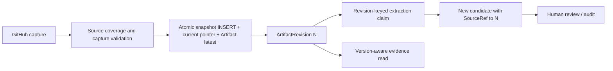

# RFC F06b — Versioned Artifacts, stable evidence, and review-safe re-extraction

**Status:** Proposed / design-only Draft PR — no schema or runtime changes; database-support scope confirmed, other design gates pending
**Date:** 2026-10-29
**Original baseline:** `main@8aa461f5bc30f16e023c9c00f0d641794fd16f86`; **reconciled with:** `main@28b58eb1388c25a0a1ab3f1cca3c1848da4c2a0c`
**Related:** F06a current-quote diagnostics PR #32 (Draft); A01 safety PR #26 and F04/F05 integration PR #35 (merged); F04/F05 duplicate Drafts #30/#31; Issue #36 worker control-plane safety (open)
**Decision required:** Approve or revise data model and rollout gates before starting the migration implementation.

## 1. Problem and evidence

The current `ArtifactRepository.upsert` updates `artifacts.content` and `metadata_json` in place for the key `(workspace_id, type, source_id)`. `SourceRef` stores only `artifact_id`, historical quote, and offsets; no source revision is recorded. `CandidateExtractionPipeline` excludes an artifact entirely when *any* SourceRef exists for that artifact. Consequently a source that changes after human approval can silently change the evidence shown by a decision while preventing new extraction. Old offsets can point into different text.

F06a detects when a stored quote is absent from *today's* artifact content, but cannot reconstruct the source version actually reviewed. A successful current-content substring match is not proof of original reviewed version or remote authenticity.

**Invariants (non-negotiable):**
1. A human-reviewed Decision, SourceRef, and audit event are never rewritten, removed, or automatically relabeled by a new import or extraction.
2. Each *new* extraction's SourceRefs are bound to one immutable, locally captured ArtifactRevision; existing pre-migration refs remain explicitly **legacy unbound**.
3. Repeating an import of the same captured revision is idempotent. A distinct revision is added append-only; the current-pointer update is atomic with it.
4. Source capture hashes prove only local byte integrity. A Git blob SHA comparison adds transport consistency where available; it is **not** an attestation of upstream ownership or human decision adoption.
5. Failure/partial import, non-verified capture, or model failure must not upgrade a revision's verification state or advance a success watermark.

## 2. Proposed model (expand-only first, implementation gated)

Keep `artifacts` as the existing stable *source identity* and latest-materialized content for backward compatibility. Introduce:

### `artifact_revisions` — immutable capture snapshots

| Column | Type / rule | Purpose |
| --- | --- | --- |
| `id` | integer PK | Stable revision identity |
| `artifact_id` | FK artifacts.id, NOT NULL | Stable source identity |
| `revision_number` | integer NOT NULL | Monotonic per artifact, uniqueness with artifact_id |
| `capture_fingerprint` | CHAR(64), NOT NULL | SHA-256 over versioned **canonical** snapshot fields, excluding captured_at; unique per artifact |
| `content_sha256` | CHAR(64), NOT NULL | SHA-256 of exact UTF-8 `content` bytes |
| `content` | TEXT NOT NULL | Exact locally captured textual content, including empty string |
| `title`, `url` | nullable snapshot columns | Prevent URL/title drift in historical evidence |
| `source_metadata_json` | JSON nullable | Captured source-ref/ref/commit/PR metadata (do not embed secrets) |
| `capture_method` | bounded string | github_api / github_contents_api / legacy_snapshot / other |
| `source_git_blob_sha` | nullable CHAR(40) | Git blob identity if genuinely checked |
| `verification_state` | enum-like string | `local_hash_only`, `git_blob_matched`, `legacy_unverified` |
| `captured_at` | UTC instant, NOT NULL | Observation time, **not** source-modified time |

Use unique `(artifact_id, revision_number)` and `(artifact_id, capture_fingerprint)` plus index `(artifact_id, captured_at)`. Define fingerprint canonicalization and schema version explicitly; normalize JSON key order/number/string encoding and include identity-relevant title, URL, content, source revision metadata. Do not use capture time in the hash (avoids a new revision for every identical poll). A changed source URL or selected metadata can constitute a new snapshot even if content text is identical.

The database layer must expose only INSERT and SELECT operations for revisions; direct UPDATE and DELETE are disallowed at the repository API level and covered by append-only tests. Application-only immutability is not a substitute for DB permissions/audit in stronger deployments.

### `artifact_current_revisions` — atomic current pointer

Columns `artifact_id` (PK, FK artifacts), `revision_id` (FK artifact_revisions), `updated_at` (UTC). An application invariant enforces that both IDs belong to the same artifact, with a transactional row lock/conditional compare-and-swap where the backend permits it. Put pointer insertion/advance, revision insertion, and the latest materialized `artifacts` update in **one transaction**. Never let a stale concurrent import roll the pointer backwards; optimistic sequence/version verification and deterministic source ordering are required.

A separate pointer table avoids rewriting the existing SQLite `artifacts` table during the expand phase. An alternative nullable `artifacts.current_revision_id` requires explicit SQLite migration review; choose one before implementation.

### `source_refs.artifact_revision_id` — nullable FK, additive

New SourceRefs must set a non-null revision ID **and** verify its artifact_id matches SourceRef.artifact_id. Keep legacy records nullable. Expose `revision_binding = "bound" | "legacy_unbound"` and the captured revision identity to authorized readers.

**Historical backfill rule:** Create one `legacy_snapshot` representing the artifact's *current database content at migration time*. Do **not** attach preexisting SourceRefs to it: their evidence could have been reviewed against earlier content. Even if quote matching succeeds now, retroactive binding would be an unsupported claim. Do not infer source Git SHA or trust from a local hash.

### `artifact_extraction_runs` — revision-scoped processing outcome

Fields: `id`, `artifact_revision_id`, `extractor_fingerprint` (prompt/model/config version), `status` (`pending|running|succeeded|skipped|failed`), `candidate_count`, `failure_code`, `attempt_count`, timestamps, `created_decision_ids_json` (bounded optional). Unique `(revision_id, extractor_fingerprint)` for completed claims, with an explicit lease/worker crash recovery policy rather than treating a timed-out running row as completed.

Replace `SourceRefRepository.exists_for_artifact(id)` as the **sole** extraction skip key only after this table is live. A revision with zero produced decisions must still record a completed/skipped extraction outcome; failure remains retryable with bounded attempts. Changing extractor configuration should require a deliberate reprocess policy and cost guardrail.

## 3. Read and review semantics

- Current evidence: link directly to a revision snapshot; do **not** automatically resolve an old quote against the mutable latest Artifact.
- `revision_binding="legacy_unbound"`: historical quote and current mismatch diagnostics may be shown, but mark capture revision unknown, never fabricate a reference to the migration-time snapshot.
- A SourceRef created from revision N remains pinned to N after import of revision N+1. Its original quote and original offsets remain immutable.
- New candidate decisions from N+1 are always `candidate`, never overwrite existing `accepted`/`rejected` decisions. Optionally link candidates to a previous decision as **proposed update**, without automatic supersession or adoption.
- The read API should return `source_revision_id`, `source_revision_number`, `source_revision_status` (`current|superseded|legacy_unknown`) and honest `capture_verification_state`. Every new API field is additive during rollout; UI badges are not proof labels.
- Access controls use the referenced Artifact's Workspace/owner scope, not user-supplied revision ID alone. Prevent cross-scope revision enumeration and leakage of private source text.

## 4. Transaction and ordering

- Import F04 may fail closed on an incomplete GitHub pagination/tree response; preserve that failure. F05 bounds the next rescan but cannot guarantee all source updates. Source revision is created **only** for data actually fetched and locally validated.
- P0 PR #26 addresses current progress commits that can persist partial Artifacts; require transaction boundary review before deploying dual-write, or ensure revision insertion + pointer never share an early progress commit.
- Concurrent import A/B: capture an immutable branch/commit ref when available; never equate a moving `main` branch name with an immutable version. GitHub docs should ideally be fetched by tree commit SHA and verified against tree blob SHA; PR/issue content has weaker upstream version guarantees and needs explicit uncertainty state.
- Rollback: if any upsert, revision, pointer or claim creation fails, no partially updated pointer/Artifact is committed. On extraction failure, historical revisions remain durable and extraction outcome records failure separately; do not rewrite human decisions.

## 5. Migration and deployment plan

**Phase 0 — RFC approval (this PR):** Choose canonical fingerprint, pointer strategy, supported database backends, privacy/retention policy, source provenance semantics. No migrations or production behavior.

**Phase 1 — expand schema:** Alembic 0013 (after 0012), create revision and current-pointer tables, nullable SourceRef revision FK, extraction-run table, indexes/constraints. Test SQLite migration from 0012 and clean head, SQL dialect compatibility, idempotent replay where appropriate. Old application code continues to work.

**Phase 2 — safe dual-write and honest backfill:** Newly imported contents write revisions and current pointer in the same transaction; repeat identical imports reuse the revision. One resumable, bounded backfill per existing Artifact captures **current** content as `legacy_unverified`. Never mutate legacy SourceRefs. Re-run checks, partial batch retry, and audit counts required.

**Phase 3 — read path / audit:** Add additive version identity to SourceRef and decision APIs with authorization. Add older revision view only behind permission check. UI displays historical/current/unknown states; F06a current-text check remains a supplementary diagnostic. Verify old review history is unchanged byte-for-byte.

**Phase 4 — guarded extraction:** Introduce revision-keyed extraction claims, bounded retries and operator-triggered reprocess. Only create new candidates, never auto-accept/supersede old ones. Cost/time budgets, dedup and model provenance per run, queue crash recovery and concurrency tests required.

**Phase 5 — contract and cleanup, separate decision:** Only after all readers/writers are migrated and backup recovery tested, consider removing `artifacts.content` duplication. Never drop legacy data because a new table exists.

### Data retention / size risk

Historical version text duplicates private source data and can grow without bound. Before Phase 2: measure per-workspace storage growth, specify maximum capture bytes and pruning/export policy compatible with auditable SourceRefs; do not delete revisions still referenced by any SourceRef. Encryption-at-rest, DB backups, tenant isolation and deletion/export requests must cover revision snapshots as well as current Artifacts. Do not put GitHub API tokens in metadata snapshots.

## 6. Acceptance matrix and release gates

| Scenario | Expected behavior |
| --- | --- |
| Same source bytes + relevant metadata fetched repeatedly | 1 revision, stable pointer and no duplicate completed extraction |
| Content or meaningful source metadata changes | New immutable revision, old one remains readable |
| Review accepted on N, source changes to N+1 | Acceptance/SourceRef/audit unchanged; new candidate (if any) requires review |
| Migrating existing accepted SourceRef | `legacy_unbound`, no invented revision ownership |
| Current source quote disappears | F06a mismatch shown; historical quote remains available |
| Update interrupted before commit | Neither current pointer nor materialized Artifact advances |
| Two concurrent imports complete out of order | Current pointer never regresses to stale source revision |
| Failed/empty/timeout extraction | Explicit per-revision outcome; safe bounded retry, no duplicate accepted decision |
| Unauthorized tenant requests another scope's revision | No private content leak, even when guessing revision ID |
| SQLite and PostgreSQL migration from representative existing data | Existing data stays readable, composite FKs/uniqueness behave correctly; SQLite desktop packaging and file recovery evaluated separately |
| Large repeated capture + backfill interruption | Storage bounds visible, resumable/idempotent migration |

**Required before any code merge:** schema/retention review, verified CI on final head, explicit rollback plan, migration rehearsal on a copy of test/representative data, authorizer test, approval for changed storage costs. **Do not claim live acceptance from synthetic CI.**

## 7. Explicitly undecided questions

1. Canonical snapshot fingerprint fields and comparison semantics for metadata-only updates.
2. **Database deployment choice confirmed 2026-11-03:** PostgreSQL + pgvector for server/full stack and SQLite for local/lightweight use, including a possible future packaged desktop edition. MySQL is out of scope; portable transaction/locking behavior still requires implementation decisions.
3. Storage retention of private repo snapshots, backup and user-data deletion semantics.
4. Source-specific immutable identity for issues/PRs (API doesn't provide Git blobs for editable bodies).
5. Worker lease and model extraction fingerprint semantics, budget for automatic or manual re-extraction.
6. UX copy for `legacy_unbound` and cases where quote matches but revision authenticity is unknown.

## 8. Review-to-implementation checklist

- [ ] Maintainer records ADR approval for invariants, fingerprint, retention and pointer table.
- [ ] PR-A: additive Alembic migration, constraints and cross-backend tests (no behavior).
- [ ] PR-B: atomic revision dual-write, no legacy-ref relinking, migration tool + count report.
- [ ] PR-C: authenticated version-aware read APIs + UI evidence state.
- [ ] PR-D: revision-keyed extraction outcomes / candidate-only reprocessing.
- [ ] Rebase each implementation PR on accepted earlier PRs; do not stack changes on unmerged #26/#32 without declaring dependency.
- [ ] Verify real operational import, failure recovery, and cost/retention before merging feature activation.

This RFC itself changes **no code, schema, data, review state, or import activity**. The supported database pair is confirmed; the optional desktop-app packaging direction is a proposed product target, not a delivered capability or approval to activate F06b.

## 9. Database support decision and future lightweight desktop edition (2026-11-03)

### Confirmed support scope and product direction

The maintainer confirmed **PostgreSQL + pgvector for the real/server full stack** and **SQLite as the lightweight/local database**. **MySQL is not a supported DecisionAtlas target** in this phase. Following the maintainer's question about packaging the app, a **future desktop edition backed by SQLite is the preferred product direction for investigation**, not a shipping guarantee or an approval to merge a packager now. SQLite must therefore be treated as a first-class local persistence target, not only as disposable CI fixture storage.

| Deployment profile | Database | Expected topology | Constraints / release boundary |
| --- | --- | --- | --- |
| Server / team | PostgreSQL + pgvector | Web + Fastify + Engine, Docker/managed services | Multi-user authorization, server jobs, operational backup/monitoring; full acceptance on PostgreSQL |
| Local / lightweight (current demo, future desktop) | SQLite database file | One locally controlled Engine process (and packaged frontend/API in the future) | Offline-first storage; one writer coordination; bounded startup/migrations, backup/restore, clean exit and local auth; not a multi-user server substitute |
| MySQL | Not supported | None | Do not maintain unverified migration claims or block F06b on MySQL-only rehearsal |

**The two databases use the same evidence invariants**: append-only revisions, SourceRef immutability, legacy-unbound historical references, valid same-Artifact composite FK, predictable uniqueness and atomic pointer changes. A passing SQLite test alone does not establish PostgreSQL correctness; likewise, a green PostgreSQL migration does not establish safe packaged SQLite behavior.

### Packaging architecture — direction, not implementation

A future Windows/macOS/Linux build can embed the frontend and local Engine/API with a per-user SQLite file. Packaging technology (Tauri, Electron, native WebView or another shell), distribution signing/notarization, auto-update strategy and bundled Python runtime are **separate future ADRs**. Do not add these dependencies to F06b Phase 1.

- **User data directory:** put the SQLite file, import cache, attachments, backups and logs in the OS-recommended writable per-user application-data directory, **never** beside installed executable/resources or inside a read-only app bundle. Resolve paths independently of the current working directory. Prevent accidental path traversal and unsafe user-controlled database paths.
- **Startup and schema compatibility:** run an explicit, versioned Alembic compatibility check before serving requests. Migrate only under a single-instance lock and after a verified backup. An older app opening a newer schema must **refuse incompatible writes** with a clear recovery path; app auto-update cannot blindly downgrade a user DB.
- **SQLite connection policy:** enforce \`PRAGMA foreign_keys=ON\` on **every new connection**, not just on the first pooled connection; test this in production-like Engine factory paths. Explicitly evaluate WAL journal mode, short transactions, bounded \`busy_timeout\`, checkpointing, and multi-process single-writer contention. Current \`get_engine()\` only configures timeout and \`check_same_thread=False\` and executes \`PRAGMA busy_timeout\` once: this is a starting point, **not** completed desktop safety.
- **Single-writer worker design:** keep importing/indexing/model jobs out of long SQLite write transactions; serialize local writes or queue them where necessary. \`SELECT ... FOR UPDATE\` is PostgreSQL-only; a SQLite \`BEGIN IMMEDIATE\` plus short transactions/retry policy needs separate acceptance. Issue #36 explicitly reproduces a pause request blocked by an active write; the Engine \`IMPORT_PAUSE_RESUME_ENABLED=false\` default must remain in place in desktop builds until that lifecycle is genuinely fixed.
- **Backup and safe restore:** use SQLite's online backup API or a well-defined quiesced/checkpointed backup, not arbitrary copying of an active \`.db\` while WAL/SHM files are live. Verify integrity and restore on realistic user datasets. Handle disk full, power loss, long migrations, failed auto-update and rollback without silently deleting review evidence.
- **Security:** do not ship API keys, default admin credentials or private GitHub tokens inside the installer or SQLite file. Store local secrets in a supported OS-protected credential store where practical; decide whether at-rest encryption is required (ordinary SQLite does **not** encrypt data at rest). Protect per-user file permissions, backups, logs and deletion/export of private captured source revisions.
- **Local search contract:** PostgreSQL pgvector queries are **not automatically available** in SQLite. Existing SQLite JSON embedding storage and demo/fake providers do not prove full parity. Specify a local-search fallback (e.g. bounded exact/keyword search or separately reviewed SQLite vector index), its dataset limits, and an explicit capability indicator. Do not quietly disable evidence integrity or claim server-grade semantic-search performance in the desktop build.
- **Offline behavior:** local browsing, review and saved evidence can work without network or a model account; GitHub import and live providers require connectivity or explicit offline/fake modes. Jobs interrupted by app shutdown must be marked/recovered deliberately, not automatically replay paid extraction or silently advance watermarks.

### Desktop-oriented release matrix (separate from schema-only CI)

1. Fresh user profile: application creates database in writable per-user data dir, initializes schema and opens the local UI without PostgreSQL/Redis installed (or clearly documents any retained dependencies).
2. Realistic existing SQLite file: upgrade from 0012 to 0013 without changing old SourceRefs; capture an on-disk backup first; verify row counts, review audit and fresh DB integrity; prove clean restart and older-app version guard.
3. Connections: cross-connection \`foreign_keys=ON\`, same-Artifact composite FK rejection, duplicate revision rejection, no retroactive legacy-ref binding and no lost updates under two competing local writers.
4. Data safety: WAL/checkpoint, backup/restore after crash or interrupted migration, near-full disk behavior and controlled failure message; migration may run longer on a large \`source_refs\` table due to Alembic SQLite batch table recreation.
5. Lifecycle: shutdown while import/extraction is pending, stalled writer contention, exactly-once claim after restart, bounded HTTP response during locks; keep controls disabled until Issue #36 is accepted.
6. Security & privacy: access to other OS profiles, app data permissions, backup/export/delete behavior, no logs or installer-bundled credentials, and source-snapshot storage budget.
7. Search: state and test the explicit SQLite search capability/limits compared with PostgreSQL+pgvector, including no-network mode.
8. Packaging smoke: signed/unsigned test build where appropriate, clean install/launch/uninstall/reinstall preserves user data, auto-update never silently destroys the DB; actual Windows/macOS/Linux matrix depends on a later packaging ADR.

### F06b rollout gate impact

- **Phase 1 #34 remains schema-only and Draft**, but its acceptance must include PostgreSQL 17 and file-backed SQLite from existing data plus a plan for large-table SQLite batch-copy downtime, and must not list MySQL as a required/validated backend.
- **Canonical fingerprint proposal:** \`content_sha256\` hashes exactly the persisted UTF-8 content bytes; \`capture_fingerprint\` will hash a version-tagged canonical serialization of content digest, stable Artifact identity, title/URL and an explicit allowlist of source revision metadata, excluding credentials, timestamps of capture, volatile polling metadata and arbitrary JSON. Precise encoding, Unicode, UTC timestamps, null/empty and golden test vectors **still require separate sign-off** before any writer is activated.
- **Pointer/CAS proposal:** one transaction binds revision insert, current pointer advance and materialized Artifact update. PostgreSQL uses locked existing Artifact row + compare-and-swap; SQLite uses short write-gated transaction with expected-pointer check and bounded retry. Ordering by local insertion number alone cannot prove source recency; equal or incomparable source tokens must be handled conservatively, never silently promoted as newer.
- **Immutability proposal:** repository INSERT/SELECT-only is insufficient; define restricted PostgreSQL app permissions and SQLite write-path guards/triggers with an authorized, auditable data-deletion mechanism. Revisions referenced by SourceRefs cannot be pruned without a separate legal/privacy policy. Private snapshot retention and encryption strategy remain **unapproved**.

**Decision ledger:** database pair = **confirmed**; lightweight desktop use = **future product direction**; packaging framework, fingerprint v1 wire format, CAS/source ordering, DB immutability, retention/encryption and actual schema deployment = **pending ADR / human review**. No migration or runtime behavior is authorized by editing this RFC.

## 10. F06b v1 architecture decision record — concrete implementation contract (2026-11-03)

**Status:** proposed technical decisions for maintainer review; the database support choice in §9 is the only decision explicitly approved so far. The contracts below define a conservative v1 target for implementation review and **do not authorize** applying #34, changing writers, processing private data, or spending on model inference.

| ADR ID | Decision for proposed v1 | Status |
| --- | --- | --- |
| F06b-01 Database profiles | PostgreSQL 17 + pgvector for server; file-backed SQLite for lightweight/local/future desktop; **no MySQL** | **Maintainer-confirmed** |
| F06b-02 Snapshot identity | One stable Artifact identity with append-only, content-addressed ArtifactRevision rows; same stable fingerprint deduplicated; capture occurrence is **not** revision identity | Proposed |
| F06b-03 Canonical bytes/hash | Exact locally persisted UTF-8 content for \`content_sha256\`, plus a domain-separated \`capture_fingerprint\` with a versioned and restricted canonical metadata allowlist | Proposed |
| F06b-04 Current pointer / concurrency | Separate \`artifact_current_revisions\` with compare-and-swap of the observed current revision; **never blindly replace** pointer after a competing writer wins; write snapshot, pointer and materialized latest Artifact in one transaction | Proposed |
| F06b-05 Legacy / audit | Existing SourceRefs remain NULL/\`legacy_unbound\`; new refs must bind same-Artifact revision; reviewer state/audit and original quote bytes never change on import | Existing invariant, design confirmation pending |
| F06b-06 Immutability and private data | No ordinary UPDATE/DELETE of revision bytes; protection at DB permissions/trigger layer, with a separately authorized, audited privacy-erasure exception and protected backups | Proposed; retention days / deletion process pending |
| F06b-07 Extraction | One claim keyed by revision + extractor fingerprint; bounded retry with lease/recovery design; new candidates only, no automatic review or chargeable re-extraction | Proposed; worker protocol pending |
| F06b-08 Return/reappearance episodes | Same content reappearing after another version may reuse the old immutable snapshot. Model **observation/episode identity separately**, so drift recurrence is not silently suppressed | Proposed follow-up linked to A04 |

### 10.1 Hash and canonicalization contract (F06b-03)

- \`content_sha256 = sha256(content.encode("utf-8")).hexdigest()\` over the **exact text persisted** into \`artifact_revisions.content\`; no implicit Unicode NFC, newline conversion, HTML stripping, tokenization or whitespace trimming at hash time. Any upstream decoding or sanitization happens **before** this operation and is specified/tested at the ingest boundary.
- Compute \`capture_fingerprint\` from \`sha256(b"DecisionAtlas/F06b/fingerprint/v1\0" + canonical_json_utf8(payload)).hexdigest()\`. The fixed v1 payload contains \`schema_version: 1\`, \`repo\`, \`artifact_type\`, \`source_id\`, \`title\`, \`url\`, \`content_sha256\`, and \`source_metadata\` with an **explicit allowlist** of stable, evidence-relevant fields.
- Proposed initial \`source_metadata\` allowlist: \`path\` (document path where applicable), \`git_blob_sha\` **only if the downloaded blob was actually checked**, and \`source_revision_token\` **only if a source-native immutable token is validated**. Treat other metadata (capture timestamps, API pagination cursors, last-polled time, counters, incomplete-coverage flags, auth details, webhook headers, arbitrary API JSON) as **not fingerprint input**. If a field lacks a trusted value, emit explicit \`null\` or omit according to a single v1 test fixture policy rather than inventing provenance.
- \`canonical_json_utf8\`: UTF-8 JSON of **sorted keys**, no insignificant whitespace, preserve string bytes/Unicode characters (no additional normalization), reject non-finite numbers and unknown value types. Prefer string/bool/int/null and arrays of those; disallow ambiguous float/Decimal serialization in the allowlisted metadata. Define null vs absent, path normalization, case-sensitive IDs and type distinctions in checked-in golden vectors before any writer is enabled. Store \`fingerprint_version=1\` logically (either a column or an unambiguous versioned hash contract); **hash cannot be recomputed with changed v2 rules and presented as v1**.
- \`sha256\` and Git blob SHA are **different hash functions and trust claims**. Local digest equality proves local bytes match a saved digest; it does not prove source authenticity, author approval or exact review-time capture. Only label \`git_blob_matched\` when a real, bounded Git blob verification occurred.
- Re-fetching identical content/allowlisted metadata must deduplicate, without advancing \`revision_number\` or retriggering paid extraction. If content goes A→B→A, retain A and B, allow the pointer to refer to the existing A fingerprint if a fresh valid capture actually observes A again, and record a **separate observation/episode** for lifecycle history in a later reviewed schema slice. A fingerprint does not tell whether the signal disappeared and returned.

**Mandatory golden vectors:** empty string; Unicode Chinese/English text; CRLF vs LF; normalization-form differences; duplicate import; title-only/URL-only changes; allowed vs volatile metadata change; missing/null; content reverted A→B→A; invalid non-finite metadata; Git blob mismatch; no secrets in serialization or logs. Exact expected digest strings must be checked in and independently verified by both DB profiles.

### 10.2 Atomic pointer and stale writer contract (F06b-04)

1. Read current pointer (\`expected_revision_id\`, or no row) and stable Artifact identity **before** fetching remote content; record the expected value with the capture attempt. Validate F04 complete coverage, download bounds and capture provenance. Do not open a long DB write transaction during GitHub I/O or embedding/model calls.
2. Begin a **short write transaction**. PostgreSQL locks the Artifact/current pointer for the affected identity; SQLite requires a serialized writer/short \`BEGIN IMMEDIATE\` equivalent and bounded busy-retry. \`PRAGMA foreign_keys=ON\` must hold on every SQLite connection. In both backends re-read the pointer and compare it against \`expected_revision_id\`; distinguish missing row from existing row.
3. If the pointer changed, **do not advance it**, do not overwrite latest \`artifacts.content\`, and do not mark the import fully successful. Return a typed \`stale_capture\`/CAS conflict and schedule an operator-visible bounded re-fetch if configured. Never use local captured_at or auto-increment revision number as proof of remote recency.
4. If still current, find or insert the exact fingerprint (respecting \`(artifact_id, capture_fingerprint)\` uniqueness), allocate a new per-Artifact \`revision_number\` only for genuinely new content/metadata, and atomically link current pointer + materialized latest Artifact to it. Commit once. On any integrity error or partial failure, rollback the entire transaction, leaving the old pointer/content intact.
5. If identical to the already-current fingerprint, no new revision or extraction claim. Source timestamps, branch names, GitHub issue \`updated_at\` and local request completion order are insufficient to imply an immutable upstream version. Git documents may carry verified commit/blob OIDs; PR/issue bodies must report weaker verification honestly.

**Required DB tests:** competing A/B writer permutations (including same fingerprint), pointer created concurrently from missing row, stale CAS after newer success, unique-key race, rollback at each write boundary, no visible pointer to the wrong Artifact, recovery from interrupted transaction, and SQLite lock-timeout behavior with bounded response. Until these tests exist, **#34's tables are storage-only and cannot be called concurrency-safe**.

### 10.3 Immutability, retention and security contract (F06b-06)

- Ordinary importer/re-extraction/review roles: **INSERT/SELECT only** for revision bytes. PostgreSQL should use least-privilege grants plus a tested immutability rule/trigger where needed. SQLite must rely on dedicated writer paths and tested UPDATE/DELETE-rejecting triggers for accidental mutation; remember a local file owner can bypass such triggers, so do **not** claim tamper-proof local evidence.
- Immutable revision bytes and immutable reviewed SourceRef quotes/audit are distinct requirements. The DB must reject a SourceRef bound to a revision owned by a different Artifact; existing legacy refs remain unbound even when a quote matches a migration-time snapshot.
- Retention baseline **proposal**: keep revisions referenced by evidence while the workspace exists; never silently prune such revisions to save disk. Record storage counts and byte budgets per workspace. For unreferenced capture snapshots use an explicit bounded retention/pruning policy only after a real usage analysis and human consent.
- Privacy-erasure exception: workspace/account deletion or an authenticated privacy request must be able to erase source bytes from live DB, exports and retained backups under a documented schedule; use a privileged, auditable deletion/tombstone workflow, never an ordinary import/cleanup operation. After erasure, the UI must say evidence is unavailable rather than fabricate a recoverable quote. **Backup-retention duration, encryption-at-rest choice and deletion SLA are intentionally open human decisions**; ordinary SQLite provides no native at-rest encryption.
- New revisions contain potentially private GitHub text. Never snapshot tokens, session cookies, raw authorization headers, user-specific connection credentials or unbounded API response JSON. Enforce owner-scope checks for all revision reads/downloads and audit privileged revision access. Test cross-workspace ID guessing.
- Desktop SQLite: DB/backups in a per-user writable app data directory, version compatibility guard, online backup/checkpoint/restore, single-writer coordination and power-loss tests before any installer is distributed. PostgreSQL migration requires real server FK/lock and backup rehearsal.

### 10.4 Candidate-only re-extraction and stage-gate contract (F06b-07)

- Key completed extraction outcomes by \`(artifact_revision_id, extractor_fingerprint)\`, where extractor fingerprint pins model/provider/prompt/config version and output schema. A zero-candidate **succeeded/skipped** run is still a recorded outcome, not a permanent artifact-level SourceRef skip.
- No concurrent duplicate claims, no unbounded retries, no automatic paid-provider replay after crash. Require explicit lease owner, heartbeat/expiry, attempt counter and completion CAS before activation; coordinate with Issue #36's general worker lifecycle protocol.
- Never rewrite historical accepted/rejected decisions, their SourceRefs or ReviewAuditEvents. A new revision produces **new candidates** requiring independent human acceptance. A prior decision may be linked as \`proposed_update\` with explanatory evidence, never silently superseded.
- Stage order remains **A04/A05 review → A03 disabled control-plane review → RFC decision review → separate #34 additive schema/migration rehearsal → guarded writers → versioned reads → optional extraction**. Stage B (B01/B02 retrieval correctness and B03/B04 engineering quality) precedes Stage C GitHub discussion capture, provenance versioning, extraction hardening and only then Stage D public-repo quality measurement; UI/ecosystem expansion stays deferred.
- Before merging **#34**: (a) maintainer approves precise fingerprint v1 golden vectors, CAS/pointer fields, deletion/retention semantics and privilege model; (b) PostgreSQL 17 and realistic file-backed SQLite 0012→0013 migration/restore exercises PASS; (c) Alembic batch-copy cost and downgrade safeguards documented; (d) no runtime writer enabled in Phase 1. Schema CI alone does not satisfy these checks.

**Decision request remaining:** approve or amend F06b-02 through F06b-08 and choose a concrete privacy retention/deletion window. Only F06b-01 (database scope) is considered formally confirmed. Do not silently mark the other architecture decisions approved.
