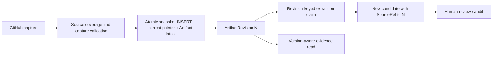

# RFC F06b — Versioned Artifacts, stable evidence, and review-safe re-extraction

**Status:** Proposed / design-only Draft PR — no schema or runtime changes
**Date:** 2026-10-29
**Baseline:** `main@8aa461f5bc30f16e023c9c00f0d641794fd16f86` (merged strategic review PR #27)
**Related:** F06a read-only quote diagnostics PR #32 (Draft); P0 import transaction integrity PR #26 (Draft); F04 coverage PR #30 and F05 watermark PR #31 (Draft)
**Decision required:** Approve or revise data model and rollout gates before starting the migration implementation.

## 1. Problem and evidence

The current `ArtifactRepository.upsert` updates `artifacts.content` and `metadata_json` in place for the key `(workspace_id, type, source_id)`. `SourceRef` stores only `artifact_id`, historical quote, and offsets; no source revision is recorded. `CandidateExtractionPipeline` excludes an artifact entirely when *any* SourceRef exists for that artifact. Consequently a source that changes after human approval can silently change the evidence shown by a decision while preventing new extraction. Old offsets can point into different text.

F06a detects when a stored quote is absent from *today's* artifact content, but cannot reconstruct the source version actually reviewed. A successful current-content substring match is not proof of original reviewed version or remote authenticity.

**Invariants (non-negotiable):**
1. A human-reviewed Decision, SourceRef, and audit event are never rewritten, removed, or automatically relabeled by a new import or extraction.
2. Each *new* extraction's SourceRefs are bound to one immutable, locally captured ArtifactRevision; existing pre-migration refs remain explicitly **legacy unbound**.
3. Repeating an import of the same captured revision is idempotent. A distinct revision is added append-only; the current-pointer update is atomic with it.
4. Source capture hashes prove only local byte integrity. A Git blob SHA comparison adds transport consistency where available; it is **not** an attestation of upstream ownership or human decision adoption.
5. Failure/partial import, non-verified capture, or model failure must not upgrade a revision's verification state or advance a success watermark.

## 2. Proposed model (expand-only first, implementation gated)

Keep `artifacts` as the existing stable *source identity* and latest-materialized content for backward compatibility. Introduce:

### `artifact_revisions` — immutable capture snapshots

| Column | Type / rule | Purpose |
| --- | --- | --- |
| `id` | integer PK | Stable revision identity |
| `artifact_id` | FK artifacts.id, NOT NULL | Stable source identity |
| `revision_number` | integer NOT NULL | Monotonic per artifact, uniqueness with artifact_id |
| `capture_fingerprint` | CHAR(64), NOT NULL | SHA-256 over versioned **canonical** snapshot fields, excluding captured_at; unique per artifact |
| `content_sha256` | CHAR(64), NOT NULL | SHA-256 of exact UTF-8 `content` bytes |
| `content` | TEXT NOT NULL | Exact locally captured textual content, including empty string |
| `title`, `url` | nullable snapshot columns | Prevent URL/title drift in historical evidence |
| `source_metadata_json` | JSON nullable | Captured source-ref/ref/commit/PR metadata (do not embed secrets) |
| `capture_method` | bounded string | github_api / github_contents_api / legacy_snapshot / other |
| `source_git_blob_sha` | nullable CHAR(40) | Git blob identity if genuinely checked |
| `verification_state` | enum-like string | `local_hash_only`, `git_blob_matched`, `legacy_unverified` |
| `captured_at` | UTC instant, NOT NULL | Observation time, **not** source-modified time |

Use unique `(artifact_id, revision_number)` and `(artifact_id, capture_fingerprint)` plus index `(artifact_id, captured_at)`. Define fingerprint canonicalization and schema version explicitly; normalize JSON key order/number/string encoding and include identity-relevant title, URL, content, source revision metadata. Do not use capture time in the hash (avoids a new revision for every identical poll). A changed source URL or selected metadata can constitute a new snapshot even if content text is identical.

The database layer must expose only INSERT and SELECT operations for revisions; direct UPDATE and DELETE are disallowed at the repository API level and covered by append-only tests. Application-only immutability is not a substitute for DB permissions/audit in stronger deployments.

### `artifact_current_revisions` — atomic current pointer

Columns `artifact_id` (PK, FK artifacts), `revision_id` (FK artifact_revisions), `updated_at` (UTC). An application invariant enforces that both IDs belong to the same artifact, with a transactional row lock/conditional compare-and-swap where the backend permits it. Put pointer insertion/advance, revision insertion, and the latest materialized `artifacts` update in **one transaction**. Never let a stale concurrent import roll the pointer backwards; optimistic sequence/version verification and deterministic source ordering are required.

A separate pointer table avoids rewriting the existing SQLite `artifacts` table during the expand phase. An alternative nullable `artifacts.current_revision_id` requires explicit SQLite migration review; choose one before implementation.

### `source_refs.artifact_revision_id` — nullable FK, additive

New SourceRefs must set a non-null revision ID **and** verify its artifact_id matches SourceRef.artifact_id. Keep legacy records nullable. Expose `revision_binding = "bound" | "legacy_unbound"` and the captured revision identity to authorized readers.

**Historical backfill rule:** Create one `legacy_snapshot` representing the artifact's *current database content at migration time*. Do **not** attach preexisting SourceRefs to it: their evidence could have been reviewed against earlier content. Even if quote matching succeeds now, retroactive binding would be an unsupported claim. Do not infer source Git SHA or trust from a local hash.

### `artifact_extraction_runs` — revision-scoped processing outcome

Fields: `id`, `artifact_revision_id`, `extractor_fingerprint` (prompt/model/config version), `status` (`pending|running|succeeded|skipped|failed`), `candidate_count`, `failure_code`, `attempt_count`, timestamps, `created_decision_ids_json` (bounded optional). Unique `(revision_id, extractor_fingerprint)` for completed claims, with an explicit lease/worker crash recovery policy rather than treating a timed-out running row as completed.

Replace `SourceRefRepository.exists_for_artifact(id)` as the **sole** extraction skip key only after this table is live. A revision with zero produced decisions must still record a completed/skipped extraction outcome; failure remains retryable with bounded attempts. Changing extractor configuration should require a deliberate reprocess policy and cost guardrail.

## 3. Read and review semantics

- Current evidence: link directly to a revision snapshot; do **not** automatically resolve an old quote against the mutable latest Artifact.
- `revision_binding="legacy_unbound"`: historical quote and current mismatch diagnostics may be shown, but mark capture revision unknown, never fabricate a reference to the migration-time snapshot.
- A SourceRef created from revision N remains pinned to N after import of revision N+1. Its original quote and original offsets remain immutable.
- New candidate decisions from N+1 are always `candidate`, never overwrite existing `accepted`/`rejected` decisions. Optionally link candidates to a previous decision as **proposed update**, without automatic supersession or adoption.
- The read API should return `source_revision_id`, `source_revision_number`, `source_revision_status` (`current|superseded|legacy_unknown`) and honest `capture_verification_state`. Every new API field is additive during rollout; UI badges are not proof labels.
- Access controls use the referenced Artifact's Workspace/owner scope, not user-supplied revision ID alone. Prevent cross-scope revision enumeration and leakage of private source text.

## 4. Transaction and ordering

- Import F04 may fail closed on an incomplete GitHub pagination/tree response; preserve that failure. F05 bounds the next rescan but cannot guarantee all source updates. Source revision is created **only** for data actually fetched and locally validated.
- P0 PR #26 addresses current progress commits that can persist partial Artifacts; require transaction boundary review before deploying dual-write, or ensure revision insertion + pointer never share an early progress commit.
- Concurrent import A/B: capture an immutable branch/commit ref when available; never equate a moving `main` branch name with an immutable version. GitHub docs should ideally be fetched by tree commit SHA and verified against tree blob SHA; PR/issue content has weaker upstream version guarantees and needs explicit uncertainty state.
- Rollback: if any upsert, revision, pointer or claim creation fails, no partially updated pointer/Artifact is committed. On extraction failure, historical revisions remain durable and extraction outcome records failure separately; do not rewrite human decisions.

## 5. Migration and deployment plan

**Phase 0 — RFC approval (this PR):** Choose canonical fingerprint, pointer strategy, supported database backends, privacy/retention policy, source provenance semantics. No migrations or production behavior.

**Phase 1 — expand schema:** Alembic 0013 (after 0012), create revision and current-pointer tables, nullable SourceRef revision FK, extraction-run table, indexes/constraints. Test SQLite migration from 0012 and clean head, SQL dialect compatibility, idempotent replay where appropriate. Old application code continues to work.

**Phase 2 — safe dual-write and honest backfill:** Newly imported contents write revisions and current pointer in the same transaction; repeat identical imports reuse the revision. One resumable, bounded backfill per existing Artifact captures **current** content as `legacy_unverified`. Never mutate legacy SourceRefs. Re-run checks, partial batch retry, and audit counts required.

**Phase 3 — read path / audit:** Add additive version identity to SourceRef and decision APIs with authorization. Add older revision view only behind permission check. UI displays historical/current/unknown states; F06a current-text check remains a supplementary diagnostic. Verify old review history is unchanged byte-for-byte.

**Phase 4 — guarded extraction:** Introduce revision-keyed extraction claims, bounded retries and operator-triggered reprocess. Only create new candidates, never auto-accept/supersede old ones. Cost/time budgets, dedup and model provenance per run, queue crash recovery and concurrency tests required.

**Phase 5 — contract and cleanup, separate decision:** Only after all readers/writers are migrated and backup recovery tested, consider removing `artifacts.content` duplication. Never drop legacy data because a new table exists.

### Data retention / size risk

Historical version text duplicates private source data and can grow without bound. Before Phase 2: measure per-workspace storage growth, specify maximum capture bytes and pruning/export policy compatible with auditable SourceRefs; do not delete revisions still referenced by any SourceRef. Encryption-at-rest, DB backups, tenant isolation and deletion/export requests must cover revision snapshots as well as current Artifacts. Do not put GitHub API tokens in metadata snapshots.

## 6. Acceptance matrix and release gates

| Scenario | Expected behavior |
| --- | --- |
| Same source bytes + relevant metadata fetched repeatedly | 1 revision, stable pointer and no duplicate completed extraction |
| Content or meaningful source metadata changes | New immutable revision, old one remains readable |
| Review accepted on N, source changes to N+1 | Acceptance/SourceRef/audit unchanged; new candidate (if any) requires review |
| Migrating existing accepted SourceRef | `legacy_unbound`, no invented revision ownership |
| Current source quote disappears | F06a mismatch shown; historical quote remains available |
| Update interrupted before commit | Neither current pointer nor materialized Artifact advances |
| Two concurrent imports complete out of order | Current pointer never regresses to stale source revision |
| Failed/empty/timeout extraction | Explicit per-revision outcome; safe bounded retry, no duplicate accepted decision |
| Unauthorized tenant requests another scope's revision | No private content leak, even when guessing revision ID |
| SQLite migration + MySQL-compatible DDL | Existing data remains readable, constraints valid |
| Large repeated capture + backfill interruption | Storage bounds visible, resumable/idempotent migration |

**Required before any code merge:** schema/retention review, verified CI on final head, explicit rollback plan, migration rehearsal on a copy of test/representative data, authorizer test, approval for changed storage costs. **Do not claim live acceptance from synthetic CI.**

## 7. Explicitly undecided questions

1. Canonical snapshot fingerprint fields and comparison semantics for metadata-only updates.
2. Actual database deployment targets (SQLite vs MySQL/PostgreSQL) and portable transaction/locking strategy.
3. Storage retention of private repo snapshots, backup and user-data deletion semantics.
4. Source-specific immutable identity for issues/PRs (API doesn't provide Git blobs for editable bodies).
5. Worker lease and model extraction fingerprint semantics, budget for automatic or manual re-extraction.
6. UX copy for `legacy_unbound` and cases where quote matches but revision authenticity is unknown.

## 8. Review-to-implementation checklist

- [ ] Maintainer records ADR approval for invariants, fingerprint, retention and pointer table.
- [ ] PR-A: additive Alembic migration, constraints and cross-backend tests (no behavior).
- [ ] PR-B: atomic revision dual-write, no legacy-ref relinking, migration tool + count report.
- [ ] PR-C: authenticated version-aware read APIs + UI evidence state.
- [ ] PR-D: revision-keyed extraction outcomes / candidate-only reprocessing.
- [ ] Rebase each implementation PR on accepted earlier PRs; do not stack changes on unmerged #26/#32 without declaring dependency.
- [ ] Verify real operational import, failure recovery, and cost/retention before merging feature activation.

This RFC itself changes **no code, schema, data, review state, or import activity**.
